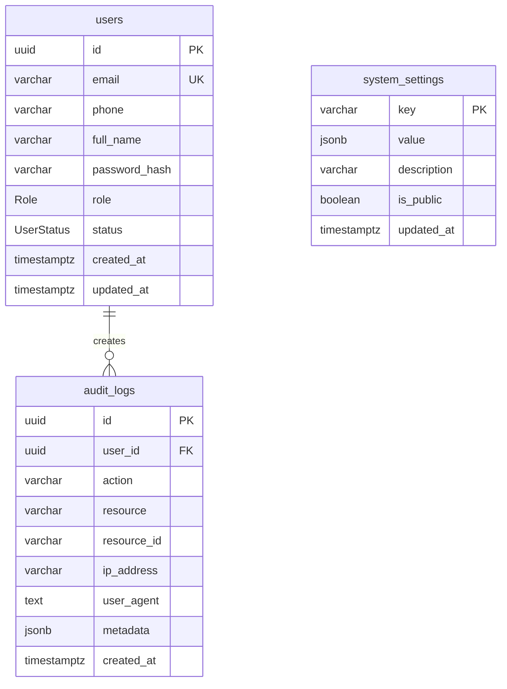

# AIC-ADT Baramati Foundation — Database Architecture Foundation

## 1. Executive Summary

This document establishes the official PostgreSQL and Prisma ORM architectural foundation for the AIC-ADT Baramati Foundation platform. In accordance with approved Architecture Decision Records ([ADR-005](file:///Users/kuldeeplakhera/ADT/Projects/AIC-ADT/docs/architecture/architecture-decisions.md#adr-005-backend-architecture--nestjs-modular-monolith), [ADR-006](file:///Users/kuldeeplakhera/ADT/Projects/AIC-ADT/docs/architecture/architecture-decisions.md#adr-006-database-engine--orm--postgresql-16-with-prisma-orm), and [ADR-007](file:///Users/kuldeeplakhera/ADT/Projects/AIC-ADT/docs/architecture/architecture-decisions.md#adr-007-lean-infrastructure-architecture--omission-of-redis--kubernetes)), the database tier utilizes **PostgreSQL 16+** with **Prisma ORM (v6.4+)**, integrated directly into the NestJS modular backend engine (`apps/api`).

This implementation enforces strict least-privilege security boundaries, loopback-only network isolation, zero credential leakage, graceful connection lifecycle management, and a controlled migration runbook.

---

## 2. Security Architecture & Role Separation

### 2.1 Least-Privilege Application Role (`aic_app`)

To guarantee data safety and prevent privilege escalation vulnerabilities, standard application runtime queries and migrations **never use a PostgreSQL superuser account**.

| Role Name | Privilege Level | Scope | Usage |
| :--- | :--- | :--- | :--- |
| `postgres` (or `aic_admin`) | **Superuser** | Cluster-level administration | Container bootstrap, database creation, role provisioning. Never exposed to application runtime. |
| `aic_app` | **Non-Superuser** (`NOSUPERUSER NOCREATEDB NOCREATEROLE`) | Database: `aic_adt_db`, Schema: `public` | NestJS runtime queries, Prisma migrations, and dev seeding. Granted only `CONNECT`, `USAGE`, `CREATE`, and DML permissions on schema `public`. |

### 2.2 Network Boundary & Interface Isolation

* **Loopback-Only Interface:** Local PostgreSQL port mappings are strictly bound to `127.0.0.1:5432:5432` in `docker-compose.yml`.
* **Zero Public WAN/LAN Exposure:** The database is completely unexposed to public interfaces (`0.0.0.0`). In production, PostgreSQL will reside in an isolated private Docker bridge network accessible only by the Nginx and NestJS application containers on the Baramati on-premise infrastructure.

---

## 3. Initial Foundational Schema Scope

### 3.1 Strict Domain Boundary Principle

In alignment with Phase 3 specifications, **only foundational core models are introduced now**. Premature introduction of future CMS articles, incubation applicants, startup directories, peer reviews, event RSVPs, or impact metrics has been deliberately avoided. Their schemas will be designed and reviewed during their respective domain implementation phases.

### 3.2 Approved Foundational Models

#### 1. `users` (Identity & RBAC Foundation)
* **Primary Key:** `UUID` via PostgreSQL native UUID generation.
* **Fields:**
  * `email`: `VARCHAR(255) UNIQUE` (Normalized lowercase email address).
  * `phone`: `VARCHAR(20)` (E.164 compliant phone number).
  * `full_name`: `VARCHAR(150)` (Founder or officer name, supports UTF-8 Devanagari script).
  * `password_hash`: `VARCHAR(255)` (Argon2id or bcrypt hash; never stored in plaintext).
  * `role`: Enum `Role` (`PUBLIC_APPLICANT`, `REVIEWER`, `PROGRAM_MANAGER`, `CONTENT_EDITOR`, `APPROVER`, `IMPACT_MANAGER`, `ADMIN`).
  * `status`: Enum `UserStatus` (`ACTIVE`, `INACTIVE`, `SUSPENDED`, `PENDING_VERIFICATION`).
  * `created_at` / `updated_at`: `TIMESTAMPTZ(6)`.
* **Indexes:** `idx_users_role`, `idx_users_status`, `users_email_key`.

#### 2. `audit_logs` (Security & Tamper-Evident Action Log)
* **Primary Key:** `UUID`.
* **Fields:**
  * `user_id`: `UUID NULL` (Foreign key to `users.id` with `ON DELETE SET NULL`).
  * `action`: `VARCHAR(100)` (e.g. `SYSTEM_BOOTSTRAP_SEED`, `AUTH_LOGIN_SUCCESS`).
  * `resource`: `VARCHAR(100)` (Target domain entity).
  * `resource_id`: `VARCHAR(255)` (Target entity identifier).
  * `ip_address`: `VARCHAR(45)` (IPv4 or IPv6 client origin).
  * `user_agent`: `TEXT` (Client user agent string).
  * `metadata`: `JSONB` (Contextual request details, diffs, or audit flags).
  * `created_at`: `TIMESTAMPTZ(6)` (Immutable event timestamp).
* **Indexes:** `idx_audit_logs_user_id`, `idx_audit_logs_action`, `idx_audit_logs_resource`, `idx_audit_logs_created_at` (Descending order).

#### 3. `system_settings` (Institutional Key-Value Configuration Store)
* **Primary Key:** `key` (`VARCHAR(100)`).
* **Fields:**
  * `value`: `JSONB` (Structured JSON parameter payload).
  * `description`: `VARCHAR(255)` (Human-readable parameter purpose).
  * `is_public`: `BOOLEAN DEFAULT false` (Declares whether key is safe for unauthenticated public clients).
  * `updated_at`: `TIMESTAMPTZ(6)`.

---

## 4. Technical Conventions

1. **Identifier Standards:** All business entities use native PostgreSQL `UUID` primary keys (`@id @default(uuid()) @db.Uuid`) to prevent ID enumeration attacks and simplify distributed data ingestion.
2. **Timestamp Standards:** All timestamps explicitly use `TIMESTAMPTZ(6)` (`timestamp(6) with time zone`), guaranteeing UTC consistency and preventing daylight savings or regional drift errors.
3. **Table & Column Naming:** Prisma schemas use camelCase model names with `@map()` and `@@map()` directives pointing to lowercase snake_case PostgreSQL tables and columns (e.g. `full_name`, `created_at`, `users`, `audit_logs`).
4. **Collation & UTF-8 Encoding:** Database clusters are initialized with `UTF-8` character encoding to ensure native Devanagari text sorting for Marathi names and locations.
5. **JSONB Usage:** Flexible configuration and metadata are stored in `JSONB` columns, enabling indexing on nested attributes without schema alteration.

---

## 5. NestJS Lifecycle & Prisma Integration

### 5.1 Architecture Components

* **`PrismaService` (`apps/api/src/database/prisma.service.ts`):**
  * Extends `PrismaClient` and implements NestJS `OnModuleInit` and `OnModuleDestroy`.
  * Configures query logging in development and error logging in production.
  * Connects via `this.$connect()` on bootstrap.
  * Catches connection failures safely and sanitizes error messages to prevent secret leakage.
  * Provides a bounded transaction helper `withTransaction<T>()` enforcing timeouts and isolation levels.
* **`DatabaseService` (`apps/api/src/database/database.service.ts`):**
  * Provides database health probes (`ping()`) executing active `SELECT 1 AS ping;` roundtrips.
  * Catches database downtime gracefully, returning `{ status: 'down', latencyMs, message }` without crashing the process.
  * Supports offline/disconnected test environments cleanly when `DATABASE_URL` is omitted.
* **`DatabaseModule` (`apps/api/src/database/database.module.ts`):**
  * Decorated with `@Global()`, making `PrismaService` and `DatabaseService` injectable throughout any backend domain module.
* **Graceful Shutdown (`main.ts`):**
  * `app.enableShutdownHooks()` intercepts `SIGTERM` and `SIGINT`, invoking `onModuleDestroy()` and cleanly terminating PostgreSQL connection pools.

---

## 6. Development Seeding Strategy

* **Script Location:** `apps/api/prisma/seed.ts`
* **Execution Command:** `pnpm --filter @aic/api prisma:seed`
* **Production Guard:** Throws an immediate critical error if `NODE_ENV === 'production'`, preventing accidental execution against live production data.
* **Idempotency:** Utilizes `prisma.systemSetting.upsert()` and `prisma.user.upsert()` to ensure subsequent seed runs update records cleanly rather than duplicating or failing on unique constraints.
