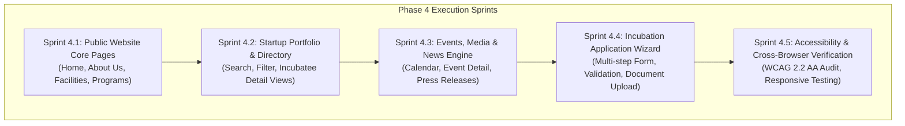

# Phase 4 Entry Gate Checklist & Readiness Sign-Off
**Project:** AIC-ADT Baramati Foundation Institutional Website  
**Phase:** Gate Transition: Phase 3 (Foundation) ➔ Phase 4 (Implementation)  
**Roles:** Principal Software Architect, Senior Full-Stack Engineer, QA Lead  
**Date:** October 10, 2026  
**Decision:** **PASSED — APPROVED FOR PHASE 4 COMMENCEMENT**

---

## 1. Phase 3 Exit Gate Verification Matrix

Each mandatory exit gate requirement defined in the AIC-ADT engineering governance charter was systematically verified against the working tree on October 10, 2026:

| # | Exit Gate Criterion | Verification Method | Result | Sign-Off Status |
| :-: | :--- | :--- | :--- | :-: |
| **1** | **Frontend Production Build** | `pnpm --filter @aic/web run build` (Next.js 16.4 Turbopack) | Compiled 5 static routes in 4.5s with zero errors | **PASSED** |
| **2** | **Backend Production Build** | `pnpm --filter @aic/api run build` (NestJS 12.1 `nest build`) | Compiled NestJS bundle in 2.7s with zero errors | **PASSED** |
| **3** | **Static Type Checking** | `pnpm typecheck` (`tsc --noEmit` across API & Web) | 0 TypeScript errors across monorepo | **PASSED** |
| **4** | **Static Linting & Formatting**| `pnpm lint` && `pnpm format:check` | 0 Oxlint errors (API), 0 ESLint errors (Web), 100% Prettier compliance | **PASSED** |
| **5** | **Automated Unit Tests** | `pnpm test` (Vitest across Web & API) | 57 passed tests (21 frontend, 36 backend) | **PASSED** |
| **6** | **Automated Integration Tests**| `pnpm test:e2e` (Supertest integration suite) | 8 passed tests (HTTP envelope, correlation IDs, Helmet, CORS) | **PASSED** |
| **7** | **Database Schema Validation** | `pnpm prisma:validate` | Validated PostgreSQL schema with 4 foundational entities | **PASSED** |
| **8** | **Docker Development Stack** | `docker compose -f infra/docker/compose.yaml config` | Compose v2 schema validated with PostgreSQL 16 Alpine | **PASSED** |
| **9** | **Zero Hardcoded Secrets** | Working tree scan + `.env.example` audit | No committed `.env` files; all secrets injected via validated environment variables | **PASSED** |
| **10**| **Phase 2 Design Token Match**| `apps/web/src/components/ui/` token inspection | 21 production React components match `#0A2540`, `#EAA22E`, WCAG AA specs | **PASSED** |
| **11**| **Phase 1 & 2 Artifact Integrity**| Directory diff & inventory check | All audit, requirements, PRD, and HTML prototypes preserved | **PASSED** |
| **12**| **Limitations & Risk Register**| Documented in `phase-3-known-issues.md` | All non-implemented business features explicitly cataloged | **PASSED** |

---

## 2. Phase 4 Prerequisites & Prerequisites Assessment

Before commencing feature development in Phase 4, ensure the following prerequisites are established:

### 2.1 Developer Environment Readiness
- [x] Node.js 20+ and pnpm 10.6+ active in local path.
- [x] Docker Desktop installed for containerized PostgreSQL service.
- [x] Local `.env` files created from `.env.example` templates in root, `apps/web/`, and `apps/api/`.

### 2.2 Foundation Capabilities Available for Phase 4
- **Shared UI Library:** 21 production-grade components ready for page composition:
  - Layout & Containers: `Container`, `Section`, `SectionHeader`, `Grid`, `MediaContainer`.
  - Content & Primitives: `Heading`, `Text`, `Overline`, `Badge`, `StatusIndicator`, `Skeleton`.
  - Interactive & Navigation: `Button`, `LinkButton`, `Tabs`, `Accordion`, `Breadcrumbs`, `Card`, `EmptyState`.
  - Form & Input Controls: `Input`, `Textarea`, `Select`, `Checkbox`, `FormLabel`, `ErrorMessage`, `FormGroup`.
- **API Foundation:** Global request pipeline ready for domain controllers:
  - Input validation pipes with DTO validation (`class-validator`).
  - Response transformation interceptor (`{ success, data, timestamp, correlationId }`).
  - Distributed tracing with `x-correlation-id`.
  - Structured logging with `AppLoggerService` (Winston JSON).
  - Health check probes (`/api/v1/health`, `/api/v1/health/liveness`, `/api/v1/health/readiness`).
  - Database repository abstraction with `DatabaseService` and `PrismaService`.

---

## 3. Recommended Phase 4 Implementation Plan

Phase 4 will focus on implementing the full public-facing institutional website, connecting frontend routes to domain-driven API services:



### Sprint Breakdown
1. **Sprint 4.1 (Public Core Pages):**
   - Homepage with institutional hero banner, stats counter, core value propositions.
   - About Us page with leadership, advisory board, and mission statements.
   - Incubation Programs page (Pre-incubation, Incubation, Acceleration).
   - Facilities and Labs showcase (Biotech, Agri-tech, IoT, Prototyping labs).
2. **Sprint 4.2 (Startup Directory):**
   - Startup index with real-time text search and sector filtering (Agri-Tech, Food-Tech, Deep-Tech).
   - Dynamic individual startup showcase pages.
   - NestJS `StartupsModule` with Prisma repository and pagination DTOs.
3. **Sprint 4.3 (Events, News & Notifications):**
   - Events listing, past events archive, and registration/RSVP flow.
   - News, circulars, and media releases.
   - NestJS `EventsModule` and `ArticlesModule`.
4. **Sprint 4.4 (Incubation Application Intake):**
   - 4-step incubation application form utilizing the validated `FormGroup`, `Input`, and `Select` components.
   - Frontend client-side validation paired with backend DTO validation.
   - File attachment handling for pitch decks and founder profiles.
5. **Sprint 4.5 (Verification & Accessibility):**
   - Automated a11y scanning (Axe-core / Lighthouse).
   - Cross-browser testing across Chrome, Safari, Firefox, and mobile Safari.

---

## 4. Exact Local Startup Commands

Execute the following commands to spin up the validated stack locally:

```bash
# 1. Start the PostgreSQL 16 Alpine container
pnpm docker:db:up

# 2. Synchronize database migrations
pnpm prisma:migrate:dev

# 3. Start development servers concurrently
pnpm dev
```

### Access URLs:
- **Public Frontend:** [http://localhost:3000](http://localhost:3000)
- **Component Showcase:** [http://localhost:3000/design-system](http://localhost:3000/design-system)
- **Backend API Root:** [http://localhost:4000/api/v1](http://localhost:4000/api/v1)
- **API Health Probes:** [http://localhost:4000/api/v1/health](http://localhost:4000/api/v1/health)

---

## 5. Formal Gate Sign-Off

The undersigned principal software architect, senior full-stack engineer, and QA lead hereby certify that the AIC-ADT website foundation satisfies all Phase 3 quality criteria with **zero critical foundation defects**.

**FINAL VERDICT: READY FOR PHASE 4.**
