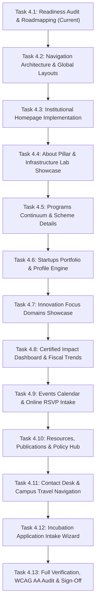

# Phase 4 Page Implementation Plan & Execution Roadmap
**Project:** AIC-ADT Baramati Foundation Institutional Website  
**Phase:** Phase 4 (Public Website & Feature Implementation) — Task 1  
**Roles:** Principal Software Architect, Senior Full-Stack Engineer, QA Lead  
**Date:** October 10, 2026  
**Status:** **CANONICAL IMPLEMENTATION ROADMAP — AWAITING SPRINT COMMENCEMENT**

---

## 1. Overview and Implementation Strategy

This document defines the sequential, task-by-task engineering roadmap for implementing the complete public-facing digital platform for the **AIC-ADT Baramati Foundation**.

### Core Engineering Principles:
1. **Foundation-First Execution:** Shared navigation primitives (`Header`, `MegaMenu`, `MobileDrawer`, `Footer`, `LanguageSwitcher`) must be fully implemented and integrated before assembling individual pages.
2. **Atomic Component Reusability:** Every page must be composed using the verified 25 UI primitives in `apps/web/src/components/ui/` and standard CSS variables, avoiding ad-hoc inline styling or unapproved hex codes.
3. **Bilingual Parity (`EN` ↔ `मराठी`):** All routes must maintain 1-to-1 parity under English and Marathi route structures with synchronized language context.
4. **Governed Content Insertion:** Unverified institutional claims (startup counts, mentor totals, private revenues) must render with approved audit badges (`[Audited as of FY 2024-25]`) or explicit verification placeholders.
5. **Rigorous Quality Gate Compliance:** Every sprint must pass type checking, linting, unit tests, responsive audits (320px–1440px), and WCAG 2.2 AA contrast standards before proceeding to the next.

---

## 2. Master Phase 4 Task Sequence

---

## 3. Detailed Page-by-Page Implementation Specifications

---

### Task 4.2: Navigation Architecture & Global Layouts
**Scope:** Re-engineer `Header.tsx`, `Footer.tsx`, and create composite navigation components.

#### Components Required:
- `apps/web/src/components/layout/Header.tsx` (Enhanced)
- `apps/web/src/components/layout/UtilityBar.tsx` (New)
- `apps/web/src/components/layout/MegaMenu.tsx` (New)
- `apps/web/src/components/layout/MobileNavDrawer.tsx` (New)
- `apps/web/src/components/layout/LanguageSwitcher.tsx` (New)
- `apps/web/src/components/layout/Footer.tsx` (Enhanced 4-column)

#### Content Dependencies:
- AIM / NITI Aayog endorsement copy (Verified).
- Primary Campus Helpline: `+91 2112 255500` (Verified).
- Canonical 7-pillar navigation taxonomy and Marathi translations (Verified).
- Official physical address: Post Box No. 35, Sharadanagar, Baramati - 413115 (Verified).

#### Responsive Requirements:
- **$\ge 1024\text{px}$:** Desktop utility bar (36px), sticky navbar (76px), active mega-menu dropdown with 1px border (`#DDE5DC`) and `--shadow-3`.
- **$< 1024\text{px}$:** Mega-menus collapse; hamburger button (44px touch target) opens slide-in mobile drawer (`width: 320px` or `85vw`) with focus trap and accordion disclosures.

#### Acceptance Criteria:
- **Given** a user navigates on desktop ($\ge 1024\text{px}$), **When** they hover or press `Enter` on "About", **Then** the mega-menu displays 2 columns of sub-links with zero layout shift.
- **Given** a user is on mobile (375px), **When** they tap the hamburger trigger, **Then** the `MobileNavDrawer` slides in, background scrolling is locked, focus moves to the close button, and pressing `Escape` dismisses the drawer.
- **Given** any screen, **When** the language toggle is clicked, **Then** the active route switches between `/` and `/mr/` while preserving URL query parameters.

---

### Task 4.3: Institutional Homepage
**Scope:** Replace developer verification page with the complete 12-section institutional homepage.

#### Routes:
- English: `/`
- Marathi: `/mr`

#### Sections & Components:
1. **Section A (Utility Strip):** `UtilityBar` with AIM acknowledgment, emergency helpline, and language switch.
2. **Section B (Main Header):** `Header` with dual logo lockup, 7 pillars, and `"Apply for Incubation"` button.
3. **Section C (Hero):** Two-column fluid grid, display heading (H1), primary CTA `[Explore Incubation Programs]`, secondary CTA `[Book Analytical Lab Testing]`, 3 credential badges (`DPIIT Recognized`, `NABL Analytical Lab`, `110-Acre Farm`), 5:4 campus photo frame.
4. **Section D (Heritage):** 3-card grid: *Lab-to-Land Science*, *Seed Funding Facilitation*, *Specialized Labs*.
5. **Section E (Programs Continuum):** 3-stage comparison: *Pre-Incubation*, *Incubation (SISFS Cohort 4 Open)*, *Acceleration*.
6. **Section F (Innovation Domains):** Segmented filter chips for 6 focus areas + featured telemetry soil sensor case study.
7. **Section G (Startup Stories):** 3 verified startup cards (*GramHeet*, *Innosapien*, *Baramati Agribiotics*) with sector badges and founder bios.
8. **Section H (Verified Impact):** Deep institutional green canvas (`#063D27`), 4 certified stat cards with explicit audit badge `[Audited as of FY 2024-25]`.
9. **Section I (Events & Deadlines):** Upcoming workshops, dates, venue tags, and seat capacity pills.
10. **Section J (Reports & Publications):** Annual report download card with certified NITI Aayog filing badge.
11. **Section K (Call to Action):** High-impact conversion banner in Forest Green (`#004B2A`) with dual actions.
12. **Section L (Institutional Footer):** 4-column directory, address, emails, legal disclaimers.

#### Content Dependencies:
- Hero headlines and editorial copy from Phase 2 spec (Verified).
- Impact metrics: Must render with `[Audited as of FY 2024-25]` badge (Conditioned).
- Startup stories: GramHeet, Innosapien, Baramati Agribiotics metadata (Verified).
- Hero image & campus photography placeholders (Placeholder required).

#### Responsive Requirements:
- **320px–375px:** Hero CTAs stack vertically (`100% width`), program cards collapse to 1 column, impact cards stack to single column, 0px horizontal overflow.
- **768px:** Hero renders 2-column flex, programs grid renders 2-column + 1 full-width card, impact cards render 2x2 grid.
- **1024px–1440px:** Full desktop grid layout matching high-fidelity design specification.

#### Acceptance Criteria:
- **Given** the homepage loads on any viewport, **Then** all 12 sections render in exact sequence without layout shift.
- **Given** a user navigates with a keyboard, **Then** the "Skip to main content" link moves focus directly to Section C.
- **Given** unverified impact claims, **Then** each metric displays the certified audit timestamp badge.

---

### Task 4.4: About Pillar Pages
**Scope:** Institutional genesis, mission, leadership roster, campus infrastructure, and partners directory.

#### Routes:
- `/about` & `/mr/about` (Institutional Overview)
- `/about/mission-vision` & `/mr/about/mission-vision` (Charter & Mandate)
- `/about/leadership` & `/mr/about/leadership` (Board & Executive Management)
- `/about/infrastructure` & `/mr/about/infrastructure` (Campus Facilities Master)
- `/about/infrastructure/[slug]` & `/mr/about/infrastructure/[slug]` (Lab Detail Pages: FabLab, Analytical Lab, Food Innovation Lab, Digital Media Lab, Co-Working Space)
- `/about/partners` & `/mr/about/partners` (Categorized Partner Directory)

#### Components Required:
- `Breadcrumbs.tsx`, `SectionHeader.tsx`, `Card.tsx`, `Grid.tsx`, `Badge.tsx`, `MediaContainer.tsx`, `Tabs.tsx`.

#### Content Dependencies:
- 50-year ADT Baramati agricultural heritage narrative (Verified).
- AIM / NITI Aayog sanction context (Verified).
- Board of Directors & Executive Staff names (Pending leadership sign-off; render verified CEO/Manager profiles + executive placeholders).
- NABL Analytical Lab testing scope (Pending certificate number; render disclaimer badge).
- Partner logos (Categorized by Govt, Academia, Corporate CSR, Investors).

#### Responsive Requirements:
- Leadership profiles reflow from 4-column (desktop) to 2-column (tablet) to 1-column (mobile).
- Facility specification tables wrap in responsive scroll container on mobile.

#### Acceptance Criteria:
- **Given** a user visits `/about/leadership`, **Then** leadership bios display with name, role, area of expertise, and verified LinkedIn links where available.
- **Given** a user visits `/about/infrastructure/analytical-lab`, **Then** laboratory equipment (GC-MS, HPLC, Spectrophotometer) and sample testing guidelines are displayed.

---

### Task 4.5: Programs Continuum & Scheme Pages
**Scope:** Flagship comparison matrix, incubation schemes (SISFS, MeitY GENESIS, CSR), mentor directory, and application instructions.

#### Routes:
- `/programs` & `/mr/programs` (Programs Overview Continuum)
- `/programs/pre-incubation` & `/mr/programs/pre-incubation` (Ideation Stage)
- `/programs/incubation` & `/mr/programs/incubation` (Seed Stage - SISFS)
- `/programs/acceleration` & `/mr/programs/acceleration` (Scale Stage)
- `/programs/schemes/startup-india` & `/mr/programs/schemes/startup-india` (SISFS Details)
- `/programs/schemes/meity-genesis` & `/mr/programs/schemes/meity-genesis` (MeitY GENESIS)
- `/programs/schemes/csr` & `/mr/programs/schemes/csr` (Capgemini, HDFC Parivartan, ED&F Man)
- `/programs/mentorship` & `/mr/programs/mentorship` (Empaneled Mentors Directory)
- `/programs/training` & `/mr/programs/training` (Capacity Building Modules)
- `/programs/apply-instructions` & `/mr/programs/apply-instructions` (Application Guide & Rubric)

#### Components Required:
- `Card.tsx`, `Badge.tsx`, `Button.tsx`, `Tabs.tsx`, `Accordion.tsx` (for FAQs), `Alert.tsx` (for active cohort deadlines).

#### Content Dependencies:
- SISFS grant tranches (up to ₹20L grant / ₹50L debt) and eligibility checklist (Verified).
- MeitY GENESIS EiR terms (up to ₹10L) and Pilot scheme guidelines (Verified).
- CSR donor partnership agreements (Verified).
- Mentor roster: Reconcile 23 verified profiles; display "Apply to Become a Mentor" intake CTA.

#### Responsive Requirements:
- Comparison matrix switches from horizontal comparison table on desktop to stacked tabbed cards on mobile.

#### Acceptance Criteria:
- **Given** a prospective founder visits `/programs/schemes/startup-india`, **Then** the page displays grant tranches, eligibility checklist, cohort intake status, and direct CTA to apply.
- **Given** `/programs/apply-instructions`, **Then** evaluation rubrics and required documents checklist are clearly enumerated.

---

### Task 4.6: Startups Pillar & Portfolio Showcase
**Scope:** Searchable and filterable portfolio directory, individual venture landing pages, and success stories.

#### Routes:
- `/startups` & `/mr/startups` (Startup Directory)
- `/startups/[slug]` & `/mr/startups/[slug]` (Individual Venture Profile)
- `/startups/success-stories` & `/mr/startups/success-stories` (In-Depth Case Studies)

#### Components Required:
- `Input.tsx` (Search field), `Badge.tsx` (Sector chips), `Card.tsx` (Startup cards), `Grid.tsx`, `EmptyState.tsx` (for zero-match queries), `LinkButton.tsx`.

#### Content Dependencies:
- Curated baseline dataset of 6 verified startups (GramHeet, Innosapien, Baramati Agribiotics, BioAgri Innovations, KisanTelemetry, MahaAgro Tech) with logos, founder names, sectors, and problem-solution summaries.
- GramHeet private turnover data conditioned with permission placeholder if unconfirmed.

#### Responsive Requirements:
- Instant search and category filter chips scroll horizontally on mobile.
- Startup card grid adapts from 3-column (desktop) to 2-column (tablet) to 1-column (mobile).

#### Acceptance Criteria:
- **Given** the startup directory, **When** a user types "AgriTech" or clicks a sector chip, **Then** matching startups filter instantly with debounced response.
- **Given** a query with no matches, **Then** the `EmptyState` component renders with a "Clear search filters" button.
- **Given** a startup profile page (`/startups/gramheet`), **Then** founder bios, problem statement, innovative solution, and website link render cleanly.

---

### Task 4.7: Innovation Focus Domains Pillar
**Scope:** Landing page and 6 deep-dive technology domain showcases articulating AIC-ADT's rural innovation areas.

#### Routes:
- `/innovation` & `/mr/innovation` (Innovation Overview)
- `/innovation/agri-tech` & `/mr/innovation/agri-tech` (Mechanization & Robotics)
- `/innovation/smart-farming` & `/mr/innovation/smart-farming` (IoT & Telemetry)
- `/innovation/food-processing` & `/mr/innovation/food-processing` (Post-Harvest & Millets)
- `/innovation/agribusiness` & `/mr/innovation/agribusiness` (Market Linkage & FPO Tech)
- `/innovation/climate-tech` & `/mr/innovation/climate-tech` (Renewable Energy & Biochar)
- `/innovation/digital-agri-ai` & `/mr/innovation/digital-agri-ai` (Machine Learning & AI)

#### Components Required:
- `SectionHeader.tsx`, `Card.tsx`, `Grid.tsx`, `Badge.tsx`, `MediaContainer.tsx`.

#### Content Dependencies:
- Field pilot study data (Soil moisture telemetry network tested across Baramati).
- High-level domain descriptions aligning with NITI Aayog AIM sectoral priorities.

#### Acceptance Criteria:
- **Given** any innovation domain page, **Then** the page details the agricultural problem, technological solution, pilot testbed outcomes, and active startups operating in that sector.

---

### Task 4.8: Certified Impact Dashboard & Fiscal Trends
**Scope:** Certified metrics dashboard, historical reporting period switcher (FY22–FY25), and field case studies.

#### Routes:
- `/impact` & `/mr/impact` (Impact Dashboard)
- `/impact/periods` & `/mr/impact/periods` (Historical Fiscal Trends)
- `/impact/case-studies` & `/mr/impact/case-studies` (Farmer & Economic Impact)

#### Components Required:
- `Card.tsx`, `Tabs.tsx`, `StatusIndicator.tsx`, `Badge.tsx`, `SectionHeader.tsx`.

#### Content Dependencies:
- Certified impact metrics with mandatory audit date tags: `[Audited as of FY 2024-25]`.
- Fiscal year data breakdown for FY 2021-22, FY 2022-23, FY 2023-24, and FY 2024-25.

#### Responsive Requirements:
- 5-column impact data tables wrapped in responsive horizontal scrolling containers (`overflow-x: auto`) on viewports $< 768\text{px}$.

#### Acceptance Criteria:
- **Given** the impact page loads, **Then** no animated counter flashes `0` or displays unverified numbers without an audit badge.
- **Given** the period switcher tabs, **When** switching from FY25 to FY24, **Then** the metrics update cleanly.

---

### Task 4.9: Events Calendar & Online RSVP Intake
**Scope:** Interactive workshop calendar, event detail page, RSVP registration form with validation, and past event archives.

#### Routes:
- `/events` & `/mr/events` (Events Calendar)
- `/events/[slug]` & `/mr/events/[slug]` (Event Detail View)
- `/events/[slug]/register` & `/mr/events/[slug]/register` (Online RSVP Form)
- `/events/past` & `/mr/events/past` (Concluded Events Archive)

#### Components Required:
- `Card.tsx`, `Badge.tsx`, `Button.tsx`, `FormGroup.tsx`, `Input.tsx`, `Select.tsx`, `Alert.tsx`.

#### Content Dependencies:
- Sample upcoming workshops (e.g., "Millet Processing Masterclass", "IoT in Precision Agriculture Workshop", "SISFS Pitch Prep Bootcamp").
- Date, venue, speaker bios, and seat capacity limits.

#### Responsive Requirements:
- Event listing items display date box left, details center, action right on desktop; stacks vertically on mobile.
- Registration form inputs span full container width on mobile with 44px min touch targets.

#### Acceptance Criteria:
- **Given** an event detail page, **When** a user clicks "Register Now", **Then** the RSVP form validates required fields (Name, Email, Mobile, Designation) and displays instant confirmation.

---

### Task 4.10: Resources, Publications & Policy Hub
**Scope:** Institutional document hub, annual reports archive, research publications, scheme guidelines, and RTI/compliance policies.

#### Routes:
- `/resources` & `/mr/resources` (Resources Hub)
- `/resources/annual-reports` & `/mr/resources/annual-reports` (Annual Progress Reports)
- `/resources/publications` & `/mr/resources/publications` (Whitepapers & Monographs)
- `/resources/program-guidelines` & `/mr/resources/program-guidelines` (Formal Guidelines)
- `/resources/policies-downloads` & `/mr/resources/policies-downloads` (Compliance, RTI & Media Kit)

#### Components Required:
- `Card.tsx`, `Button.tsx`, `Badge.tsx`, `Input.tsx` (Document search filter).

#### Content Dependencies:
- Sample PDF documents migrated from `prototype/assets/downloads/` to `apps/web/public/downloads/`.
- File size labels, publication dates, and AIM compliance badges.

#### Acceptance Criteria:
- **Given** a user clicks "Download Report", **Then** the PDF opens in a new tab or downloads directly without mixed-content errors or external redirect hazards.

---

### Task 4.11: Contact Desk & Campus Travel Navigation
**Scope:** Campus address, verified phone numbers, departmental email routing, interactive Google Maps embed, and travel guide.

#### Routes:
- `/contact` & `/mr/contact` (General Contact & Inquiries)
- `/contact/partnerships` & `/mr/contact/partnerships` (CSR & Corporate MoU Intake)
- `/contact/directions` & `/mr/contact/directions` (Campus Travel & Transit Guide)

#### Components Required:
- `FormGroup.tsx`, `Input.tsx`, `Textarea.tsx`, `Select.tsx`, `Button.tsx`, `Card.tsx`, `Alert.tsx`.

#### Content Dependencies:
- Campus physical address: Sharadanagar, Baramati, Pune - 413115 (Verified).
- Landline helpline: `+91 2112 255500` / `+91 2112 255518` (Verified).
- Departmental routing aliases (`incubation@...`, `labs@...`, `partnerships@...`).
- Travel transit instructions from Pune Airport, Daund Junction, and Baramati Bus Stand (Verified).

#### Acceptance Criteria:
- **Given** the contact form, **When** submitted without mandatory fields, **Then** accessible inline error messages render with `aria-invalid="true"`.
- **Given** valid submission, **Then** an accessible success confirmation banner renders.

---

### Task 4.12: Incubation Application Intake Wizard
**Scope:** Client-side 3-step incubation application intake flow demonstrating eligibility self-assessment, venture profile submission, and pitch deck upload.

#### Routes:
- `/apply` & `/mr/apply` (Application Portal Landing & Multi-Step Wizard)

#### Components Required:
- `Tabs.tsx` (Step indicator), `FormGroup.tsx`, `Input.tsx`, `Select.tsx`, `Textarea.tsx`, `Checkbox.tsx`, `Button.tsx`, `Alert.tsx`, `Card.tsx`.

#### Content Dependencies:
- 4-step eligibility self-assessment criteria (Registered entity, AgTech focus, prototype stage).
- DPIIT recognition number format, founder details, and pitch deck upload constraints (max 10MB PDF).

#### Acceptance Criteria:
- **Given** the 3-step wizard, **When** Step 1 is valid, **Then** the user advances to Step 2 with preserved state.
- **Given** Step 3 submission, **Then** an application reference number is generated with next-step instructions.

---

### Task 4.13: Full Verification, Accessibility & Quality Sign-Off
**Scope:** Comprehensive verification of all implemented pages against Phase 3 quality gates, WCAG 2.2 AA accessibility, responsive viewports, and Turbopack production compilation.

#### Checks:
1. `pnpm typecheck` (Zero TypeScript errors).
2. `pnpm lint` (Zero ESLint/Oxlint errors).
3. `pnpm format:check` (Prettier code style).
4. `pnpm test` (All frontend component and page tests passing).
5. `pnpm build` (All static routes compile cleanly in Next.js Turbopack).
6. Automated a11y audit across all implemented pages.
7. Responsive layout inspection across 320px, 375px, 768px, 1024px, and 1440px viewports.
