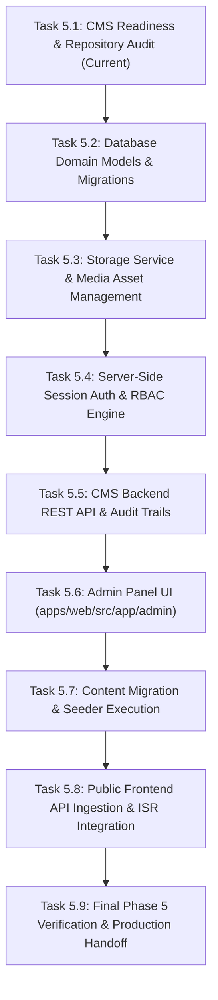

# Phase 5 Technical Blockers, Dependencies & Execution Order

**Project:** AIC-ADT Baramati Foundation Institutional Website  
**Phase:** Phase 5 — Content Management System & Editorial Workflows (Task 1)  
**Roles:** Enterprise Architect, Lead DevOps Engineer, Senior Backend Engineer  
**Date:** October 12, 2026  
**Status:** **ACTIVE BLOCKER REGISTER — 4 FOUNDATIONAL BLOCKERS IDENTIFIED**  

---

## 1. Executive Summary

This register catalogs the exact technical blockers, infrastructure dependencies, and prerequisites that currently prevent the immediate deployment of the Phase 5 Content Management System (CMS) and Admin Portal.

While the monorepo baseline is green (100% tests passing, zero lint/type errors, static build functional), **CMS administrative features cannot be built until four foundational backend and data prerequisites are completed**.

---

## 2. Active Blocker Inventory

### Blocker 1: Absence of Server-Side Session Authentication & RBAC Engine
- **Blocker ID:** `BLOCKER-P5-001`
- **Domain:** Security & Authentication / Backend Architecture
- **Severity:** **Critical Blocker**
- **Affected Components:**
  - [apps/api/src/common/decorators/roles.decorator.ts](file:///Users/kuldeeplakhera/ADT/Projects/AIC-ADT/apps/api/src/common/decorators/roles.decorator.ts)
  - [apps/api/prisma/schema.prisma](file:///Users/kuldeeplakhera/ADT/Projects/AIC-ADT/apps/api/prisma/schema.prisma)
  - `apps/web/src/app/(admin)` (Planned Admin Route Group)
- **Current State:**
  - Role enum exists in Prisma, but there is no `AuthModule`, no session table, no password verification service (argon2/bcrypt), no login endpoint, and no HTTP-only session cookie parser.
  - ADR-008 mandates server-side session authentication with HTTP-only cookies and CSRF tokens before any admin UI can be provisioned.
- **Why It Blocks CMS Implementation:**
  - Any administrative UI created without authentication would either be insecurely public or rely on temporary dummy state that violates institutional security standards.
- **Required Remediation:**
  1. Add `Session` model to `apps/api/prisma/schema.prisma`.
  2. Implement `AuthModule` with `SessionService`, `PasswordService`, and `AuthController`.
  3. Implement `AuthGuard` and `RolesGuard` enforcing cookie session validation and RBAC.
  4. Implement CSRF protection middleware for state-modifying requests (`POST`, `PUT`, `DELETE`).

---

### Blocker 2: Absence of CMS Domain Models in Database Schema
- **Blocker ID:** `BLOCKER-P5-002`
- **Domain:** Data Architecture & Database Migrations
- **Severity:** **Critical Blocker**
- **Affected Components:**
  - [apps/api/prisma/schema.prisma](file:///Users/kuldeeplakhera/ADT/Projects/AIC-ADT/apps/api/prisma/schema.prisma)
  - [apps/api/prisma/migrations](file:///Users/kuldeeplakhera/ADT/Projects/AIC-ADT/apps/api/prisma/migrations)
- **Current State:**
  - The Prisma schema currently defines only 3 models: `User`, `AuditLog`, and `SystemSetting`.
  - There are no database tables or relations for `Startup`, `Event`, `NewsArticle`, `Publication`, `Facility`, `MediaAsset`, or `ContentRevision`.
- **Why It Blocks CMS Implementation:**
  - CMS controllers and admin CRUD forms require persistent relational storage with foreign keys, indexes, and audit relations.
- **Required Remediation:**
  1. Update `apps/api/prisma/schema.prisma` with the 10 domain entities specified in [phase-5-cms-scope.md](file:///Users/kuldeeplakhera/ADT/Projects/AIC-ADT/docs/architecture/phase-5-cms-scope.md).
  2. Generate and apply migration via `pnpm --filter @aic/api exec prisma migrate dev --name add_cms_domain_models`.
  3. Regenerate Prisma Client (`pnpm --filter @aic/api prisma:generate`).

---

### Blocker 3: Absence of Media & Document Storage Service Abstraction
- **Blocker ID:** `BLOCKER-P5-003`
- **Domain:** Storage Architecture & File Management
- **Severity:** **High Blocker**
- **Affected Components:**
  - [apps/api/src](file:///Users/kuldeeplakhera/ADT/Projects/AIC-ADT/apps/api/src)
  - [.env.example](file:///Users/kuldeeplakhera/ADT/Projects/AIC-ADT/.env.example) (`STORAGE_PUBLIC_PATH`, `STORAGE_PRIVATE_PATH`)
- **Current State:**
  - The repository has environment variable placeholders for storage, but no `StorageModule`, no `IStorageService` interface, no disk write logic, and no media upload endpoints.
- **Why It Blocks CMS Implementation:**
  - Publications require PDF uploads with metadata extraction (file size, page count).
  - News, events, and startups require thumbnail and logo image uploads.
- **Required Remediation:**
  1. Create `StorageModule` in NestJS defining `IStorageService`.
  2. Implement local disk adapter (`LocalStorageService`) for local development.
  3. Implement multipart upload validation (MIME checking, size limits, antivirus hooks).
  4. Implement `MediaAsset` controller with public read and authenticated write operations.

---

### Blocker 4: Local Developer Host Docker Daemon Inactivity
- **Blocker ID:** `BLOCKER-P5-004`
- **Domain:** Local Development Environment / DevOps
- **Severity:** **Medium Blocker** (Operational Environment)
- **Affected Components:**
  - [infra/docker/compose.yaml](file:///Users/kuldeeplakhera/ADT/Projects/AIC-ADT/infra/docker/compose.yaml)
  - PostgreSQL container `aic-adt-postgres`
- **Current State:**
  - Docker Desktop is installed, but the background daemon is not running continuously on the development workstation.
  - While configuration files and migration SQL are syntactically valid and tested in CI/builds, live database mutations require an active database server.
- **Why It Blocks CMS Implementation:**
  - Running live migrations (`prisma migrate dev`) and testing live database writes requires an active PostgreSQL instance.
- **Required Remediation:**
  1. Launch Docker Desktop on the workstation or start a local PostgreSQL service.
  2. Run `pnpm docker:db:up` to provision the container.
  3. Verify connection via `pnpm --filter @aic/api prisma:migrate:status`.

---

## 3. Recommended Phase 5 Execution Order

To resolve these blockers cleanly without rework or architectural debt, Phase 5 tasks must be sequenced in strict dependency order:

| Sequence | Task Identifier | Scope & Deliverable | Depends On |
| :---: | :--- | :--- | :--- |
| **1** | **Task 5.1** | Repository Audit, Scope Definition, Migration Plan & Blocker Register | Phase 4 Closure |
| **2** | **Task 5.2** | Add Prisma CMS models (Startups, Events, News, Publications, Facilities, Revisions) and execute migration | Task 5.1 |
| **3** | **Task 5.3** | Implement `StorageModule`, `IStorageService`, local disk adapter, and media upload controllers | Task 5.2 |
| **4** | **Task 5.4** | Implement `AuthModule`, PostgreSQL sessions, HTTP-only cookie handlers, password hashing, and guards | Task 5.2 |
| **5** | **Task 5.5** | Build NestJS CMS controllers for Startups, Events, News, Publications with audit logging and revisions | Task 5.3, 5.4 |
| **6** | **Task 5.6** | Build `/admin` route group in `apps/web` with login, dashboard, side-by-side bilingual editors, and RBAC views | Task 5.5 |
| **7** | **Task 5.7** | Execute data migration script migrating verified data from `apps/web/src/data/*.ts` into PostgreSQL | Task 5.2, 5.5 |
| **8** | **Task 5.8** | Wire public Next.js routes to fetch from API with static fallbacks and on-demand ISR revalidation | Task 5.7 |
| **9** | **Task 5.9** | End-to-end integration testing, security audit, and Phase 5 completion handoff | Tasks 5.1–5.8 |

---

## 4. Final Readiness Verdict

### **VERDICT: READY WITH BLOCKERS**

**Summary Statement:**  
The AIC-ADT digital platform codebase is architecturally prepared for Phase 5. Root commands, TypeScript checking, linting, and 196 automated tests are passing with 100% success. However, **CMS development cannot begin with UI screens**; it must begin with the resolution of **Blockers 1 through 3** (Database Schema, Storage Service, and Session Authentication) in the backend engine.

Following the execution order outlined above guarantees clean domain isolation, robust security compliance, and zero regressions on the existing 77 public website routes.
