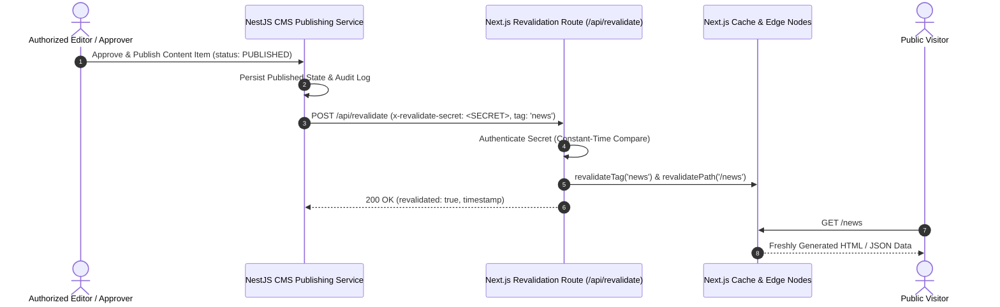

# Phase 5 — Cache Invalidation & Revalidation Architecture

This document defines how published content updates propagate from the CMS editorial backend to the public website, detailing the on-demand revalidation architecture, webhook security, tag taxonomy, and cache failure recovery.

---

## 1. Revalidation Architecture Overview

The AIC-ADT Baramati Foundation web architecture combines edge caching (HTTP CDN headers) with Next.js On-Demand Incremental Static Regeneration (ISR).

---

## 2. On-Demand Revalidation Endpoint (`/api/revalidate`)

### 2.1 Route & Authentication
The endpoint is implemented at `apps/web/src/app/api/revalidate/route.ts` as a Next.js Route Handler.

- **HTTP Method**: `POST`
- **Supported Headers**:
  - `x-revalidate-secret`: Server-to-server secret token.
  - `Authorization`: `Bearer <SECRET>`.
- **Query Parameter Fallback**: `?secret=<SECRET>` (for administrative webhook testing).

### 2.2 Security & Protection Against Exploitation
1. **Server-Only Secret**: The shared key is stored in server-side environment variable `REVALIDATION_SECRET` (fallback `CMS_WEBHOOK_SECRET`). It is NEVER prefixed with `NEXT_PUBLIC_` and never included in client JavaScript bundles.
2. **Strict 401 Rejection**: Any request missing the secret or providing an invalid secret is terminated immediately with HTTP `401 Unauthorized` without performing any cache operations.
3. **No Arbitrary Execution**: The handler accepts only explicit `path` or `tag` strings. It does NOT evaluate URLs or forward external requests, preventing Server-Side Request Forgery (SSRF).
4. **Input Validation**: Requests lacking both `path` and `tag` return HTTP `400 Bad Request`.

---

## 3. Revalidation Tag Taxonomy

To minimize unnecessary cache purges, content types use a hierarchical tag structure:

| Content Type | Global Collection Tag | Entity-Specific Tag | Primary Paths Revalidated |
| :--- | :--- | :--- | :--- |
| **News Releases** | `news`, `news-en` | `news-{slug}` | `/news`, `/news/{slug}`, `/` |
| **Events & Workshops** | `events`, `events-en`, `events-mr` | `event-{slug}` | `/events`, `/events/{slug}`, `/mr/events` |
| **Startups** | `startups` | `startup-{slug}` | `/startups`, `/mr/startups` |
| **Programs** | `programs` | `program-{slug}` | `/programs`, `/programs/{slug}` |
| **Publications** | `publications` | `publication-{slug}` | `/resources`, `/resources/annual-reports` |
| **Institutional Pages**| `pages` | `page-{slug}` | `/about/{slug}` |

---

## 4. Content Lifecycle & Invalidation Actions

### 4.1 First-Time Publication
- **Trigger**: Content item transitions from `APPROVED` to `PUBLISHED`.
- **Action**:
  - Revalidate collection tag: `revalidateTag('news')`.
  - Revalidate homepage tag if featured: `revalidatePath('/')`.
- **Result**: New item immediately appears in listings.

### 4.2 Content Update
- **Trigger**: New published revision replacing previous published content.
- **Action**:
  - Revalidate item tag: `revalidateTag('news-{slug}')`.
  - Revalidate item path: `revalidatePath('/news/{slug}')`.
  - Revalidate collection tag: `revalidateTag('news')`.
- **Result**: Updated headlines, copy, or media are reflected on public page.

### 4.3 Unpublishing or Archiving
- **Trigger**: Item transitions to `ARCHIVED` or unpublished state.
- **Action**:
  - Revalidate item path: `revalidatePath('/news/{slug}')`.
  - Revalidate collection tag: `revalidateTag('news')`.
- **Result**: Detail page immediately renders `404 Not Found`. Item disappears from all public listings.

### 4.4 Slug Modification
- **Trigger**: Editorial staff renames slug (e.g. from `/news/draft-title` to `/news/official-title`).
- **Action**:
  - Register HTTP `308 Permanent Redirect` from old slug to new slug.
  - Revalidate old path, new path, and collection tags.

---

## 5. Resilience & Failure Handling

When the CMS webhook cannot reach the Next.js revalidation endpoint (e.g. temporary network partition):

1. **Stale-While-Revalidate Fallback**: Edge caches serve existing cached pages with HTTP `stale-while-revalidate=600`, ensuring zero downtime for visitors.
2. **Background TTL Expiration**: In the absence of an on-demand invalidation trigger, the default edge TTL (`s-maxage=300` / 5 minutes) ensures that stale content expires automatically within 5 minutes.
3. **Audit Logging & Alerting**: Webhook dispatch failures in NestJS trigger a warning in `AppLoggerService` with correlation ID for administrative diagnostic review.
