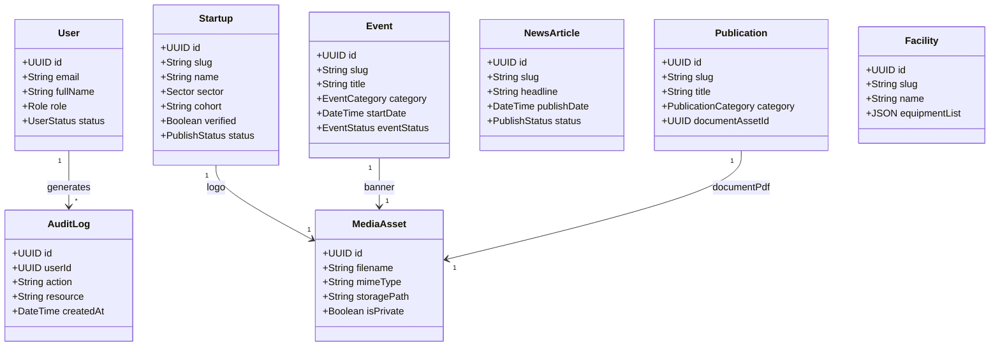

# Phase 5 CMS Scope & Domain Model Specification

**Project:** AIC-ADT Baramati Foundation Institutional Website  
**Phase:** Phase 5 — Content Management System & Editorial Workflows (Task 1)  
**Roles:** Enterprise Solution Architect, Senior Product Manager, Lead Backend Engineer  
**Date:** October 12, 2026  
**Status:** **APPROVED SPECIFICATION — DEFINITIVE CMS SCOPE**  

---

## 1. Overview & Source of Truth

This document establishes the definitive administrative scope for the AIC-ADT Baramati Foundation Headless Content Management System (CMS). 

The source of truth for all content schemas, entity fields, validation rules, and relational models is derived from:
1. The 77 approved public website routes implemented in `apps/web/src/app`.
2. The typed TypeScript data models established in [apps/web/src/data](file:///Users/kuldeeplakhera/ADT/Projects/AIC-ADT/apps/web/src/data).
3. The Fact-First Truthfulness Protocol documented in [docs/audit/content-verification-register.md](file:///Users/kuldeeplakhera/ADT/Projects/AIC-ADT/docs/audit/content-verification-register.md).
4. The Phase 4 architectural handoff checklist in [docs/architecture/phase-5-entry-checklist.md](file:///Users/kuldeeplakhera/ADT/Projects/AIC-ADT/docs/architecture/phase-5-entry-checklist.md).

---

## 2. Content Entity Inventory & Management Requirements

The CMS must provide authenticated CRUD, draft/review/publish states, bilingual fields, and audit trails for the following **10 core domains**:

---

### Entity 1: Startup Directory Records (`startups`)
- **Public Routes Supported:** `/startups`, `/startups/[slug]`, `/startups/success-stories`, `/mr/startups`
- **Data Source in Codebase:** [apps/web/src/data/startups.ts](file:///Users/kuldeeplakhera/ADT/Projects/AIC-ADT/apps/web/src/data/startups.ts)
- **CMS Model Fields:**
  - `id`: UUID (Primary Key)
  - `slug`: String (Unique, URL safe)
  - `name`: String (Startup brand name)
  - `tagline`: String (Single line value proposition)
  - `sector`: Enum (`AGRI_TECH`, `SMART_FARMING`, `BIOTECHNOLOGY`, `FOOD_PROCESSING`, `CLIMATE_TECH`, `AGRIBUSINESS`)
  - `cohort`: String (e.g., `"2024-Cohort-3"`)
  - `fundingScheme`: String (e.g., `"SISFS"`, `"MeitY GENESIS"`, `"CSR"`)
  - `founders`: String (Comma-separated founder names with credentials)
  - `location`: String (e.g., `"Pune, Maharashtra"`, `"Baramati"`)
  - `overview`: Text (Comprehensive summary of startup mission)
  - `problemStatement`: Text (Market/farming challenge addressed)
  - `solutionInnovation`: Text (Technological innovation or IP)
  - `reachMetric`: String (Verified milestone metric, e.g., `"12,000+ Farmers Impacted"`)
  - `labsUsed`: String (e.g., `"Soil & Analytical Testing Lab"`)
  - `trlLevel`: String (Technology Readiness Level, e.g., `"TRL 7"`)
  - `milestones`: JSONB Array of strings
  - `websiteUrl`: String (Optional, validated external URL)
  - `logoAssetId`: UUID (Relation to `MediaAsset`)
  - `verified`: Boolean (Strict Fact-First verification flag)
  - `featuredInHomepage`: Boolean (Display in homepage startup showcase)
  - `status`: Enum (`DRAFT`, `UNDER_REVIEW`, `PUBLISHED`, `ARCHIVED`)
  - `translations`: JSONB (Devanagari name, tagline, overview for `/mr/startups`)
- **Editorial Permissions:** Program Manager (Create/Edit), Approver / Admin (Publish).

---

### Entity 2: Events & Capacity-Building Workshops (`events`)
- **Public Routes Supported:** `/events`, `/events/[slug]`, `/events/past`, `/mr/events`
- **Data Source in Codebase:** [apps/web/src/data/events.ts](file:///Users/kuldeeplakhera/ADT/Projects/AIC-ADT/apps/web/src/data/events.ts)
- **CMS Model Fields:**
  - `id`: UUID (Primary Key)
  - `slug`: String (Unique)
  - `title`: String (Official event name)
  - `shortDescription`: String
  - `fullDescription`: Text / Array of paragraphs
  - `category`: Enum (`INTAKE_DEADLINE`, `TECHNICAL_WORKSHOP`, `FIELD_SHOWCASE`, `ECOSYSTEM_CONCLAVE`, `TRAINING_BOOTCAMP`)
  - `status`: Enum (`UPCOMING`, `REGISTRATION_CLOSED`, `CONCLUDED`, `POSTPONED`)
  - `startDate`: Timestamptz
  - `endDate`: Timestamptz
  - `timeRange`: String (e.g., `"10:00 AM – 4:00 PM IST"`)
  - `venueName`: String (e.g., `"AIC-ADT Auditorium, Shardanagar"`)
  - `venueType`: Enum (`IN_PERSON`, `ONLINE`, `HYBRID`)
  - `venueAddress`: String
  - `organizer`: String (e.g., `"AIC-ADT Incubation Secretariat"`)
  - `targetAudience`: JSONB Array of strings
  - `registrationUrl`: String (Validated link, internal or approved external)
  - `registrationDeadline`: Timestamptz
  - `isExternal`: Boolean
  - `bannerAssetId`: UUID (Relation to `MediaAsset`)
  - `translations`: JSONB (Devanagari title, description, venue)
- **Editorial Permissions:** Program Coordinator (Draft), Content Editor (Publish).

---

### Entity 3: News & Official Announcements (`news`)
- **Public Routes Supported:** `/news`, `/news/[slug]`
- **Data Source in Codebase:** [apps/web/src/data/news.ts](file:///Users/kuldeeplakhera/ADT/Projects/AIC-ADT/apps/web/src/data/news.ts)
- **CMS Model Fields:**
  - `id`: UUID (Primary Key)
  - `slug`: String (Unique)
  - `headline`: String
  - `publishDate`: Timestamptz (Supports future embargoed release)
  - `category`: Enum (`OFFICIAL_ANNOUNCEMENT`, `FUNDING_MILESTONE`, `INFRASTRUCTURE`, `ECOSYSTEM_PARTNERSHIP`)
  - `summary`: String (Concise lead paragraph)
  - `content`: JSONB Array of paragraphs
  - `sourceAttribution`: String (Mandatory: institutional source or authority)
  - `externalPressLink`: String (Optional press reference)
  - `tags`: JSONB Array of strings
  - `keyFacts`: JSONB Array of `{ label: string, value: string }`
  - `thumbnailAssetId`: UUID (Relation to `MediaAsset`)
  - `status`: Enum (`DRAFT`, `UNDER_REVIEW`, `PUBLISHED`, `ARCHIVED`)
  - `translations`: JSONB (Devanagari headline, summary, content)
- **Editorial Permissions:** Content Author (Draft), Content Editor / Admin (Publish).

---

### Entity 4: Reports, Publications & Policy Disclosures (`publications`)
- **Public Routes Supported:** `/resources`, `/resources/annual-reports`, `/resources/publications`, `/resources/program-guidelines`, `/resources/policies-downloads`, `/mr/resources`
- **Data Source in Codebase:** [apps/web/src/data/publications.ts](file:///Users/kuldeeplakhera/ADT/Projects/AIC-ADT/apps/web/src/data/publications.ts)
- **CMS Model Fields:**
  - `id`: UUID (Primary Key)
  - `slug`: String (Unique)
  - `title`: String
  - `category`: Enum (`ANNUAL_REPORT`, `RESEARCH_WHITEPAPER`, `PROGRAM_GUIDELINE`, `POLICY_COMPLIANCE`, `BRAND_ASSET`)
  - `reportingPeriod`: String (Optional, e.g., `"FY 2024-25"`)
  - `publishDate`: Timestamptz
  - `summary`: Text
  - `keyHighlights`: JSONB Array of bullet highlights
  - `issuingAuthority`: String (e.g., `"AIC-ADT Governing Council"`, `"NITI Aayog"`)
  - `verificationBadge`: String (e.g., `"Statutory Filing"`, `"Peer-Reviewed"`)
  - `documentAssetId`: UUID (Mandatory relation to `MediaAsset` of type PDF)
  - `fileSizeBytes`: BigInt
  - `pageCount`: Integer
  - `isStatutory`: Boolean (Requires legal review prior to modification)
  - `status`: Enum (`DRAFT`, `PUBLISHED`, `ARCHIVED`)
- **Editorial Permissions:** Legal / Compliance Officer (Review), Content Editor (Publish).

---

### Entity 5: Incubation Programs & Government Schemes (`programs`)
- **Public Routes Supported:** `/programs`, `/programs/pre-incubation`, `/programs/incubation`, `/programs/acceleration`, `/programs/mentorship`, `/programs/training`, `/programs/apply-instructions`, `/programs/schemes/*`, `/mr/programs`
- **Data Source in Codebase:** [apps/web/src/data/programs.ts](file:///Users/kuldeeplakhera/ADT/Projects/AIC-ADT/apps/web/src/data/programs.ts)
- **CMS Model Fields:**
  - `id`: UUID (Primary Key)
  - `slug`: String (Unique)
  - `name`: String
  - `type`: Enum (`CORE_PROGRAM`, `FUNDING_SCHEME`)
  - `stage`: String (e.g., `"Ideation & Proof of Concept"`, `"Commercialization"`)
  - `duration`: String (e.g., `"6 Months"`, `"12-18 Months"`)
  - `trlLevel`: String (e.g., `"TRL 2-4"`)
  - `tagline`: String
  - `summary`: Text
  - `audience`: JSONB Array of strings
  - `offerings`: JSONB Array of strings
  - `eligibility`: JSONB Array of criteria
  - `selectionProcess`: JSONB Array of steps
  - `fundingScope`: String (e.g., `"Grant up to ₹25 Lakhs via SISFS"`)
  - `status`: Enum (`ACTIVE_INTAKE`, `ROLLING_REVIEW`, `UPCOMING_CALL`)
  - `applicationUrl`: String
  - `translations`: JSONB (Devanagari name, offerings, eligibility)
- **Editorial Permissions:** Program Manager (Manage), Admin (Approve).

---

### Entity 6: Innovation Domains & Technology Pilots (`innovation`)
- **Public Routes Supported:** `/innovation`, `/innovation/agri-tech`, `/innovation/smart-farming`, `/innovation/biotechnology`, `/innovation/food-processing`, `/innovation/climate-tech`, `/innovation/digital-agri-ai`, `/mr/innovation`
- **Data Source in Codebase:** [apps/web/src/data/innovation.ts](file:///Users/kuldeeplakhera/ADT/Projects/AIC-ADT/apps/web/src/data/innovation.ts)
- **CMS Model Fields:**
  - Domain records: Slug, title, description, focus areas, facilities linked, pilot hectares, faculty leads.
  - Showcase items: Title, domain slug, category, status (`DEPLOYED_SERVICE`, `TECH_DEMONSTRATION`, `ACTIVE_RESEARCH`), lead entity, technical specifications (`label`, `value`).

---

### Entity 7: Infrastructure Facilities & Lab Equipment (`facilities`)
- **Public Routes Supported:** `/about/infrastructure`, `/about/infrastructure/[slug]`
- **Data Source in Codebase:** [apps/web/src/data/institutional.ts](file:///Users/kuldeeplakhera/ADT/Projects/AIC-ADT/apps/web/src/data/institutional.ts)
- **CMS Model Fields:**
  - Facility profiles: Slug, name, accreditation (e.g., `"NABL TC-8241"`), tagline, description, key features, equipment list (`name`, `model`, `capacity`, `specifications`), booking guidelines, lab in-charge contact.

---

### Entity 8: Institutional Governance & Leadership (`institutional`)
- **Public Routes Supported:** `/about`, `/about/leadership`, `/about/mission-vision`, `/about/partners`, `/mr/about`
- **Data Source in Codebase:** [apps/web/src/data/institutional.ts](file:///Users/kuldeeplakhera/ADT/Projects/AIC-ADT/apps/web/src/data/institutional.ts)
- **CMS Model Fields:**
  - Leadership team: Name, role, designation, organization, bio, order index, photo asset ID.
  - Governing board & advisory council: Name, primary affiliation, representation (Trustee, AIM Nominee, Industry Expert).
  - Institutional milestones: Year, title, description, category (`Heritage`, `Sanction`, `Scale`).

---

### Entity 9: Media Assets & Document Management (`media_assets`)
- **Storage Subsystem:** Local volume (`/storage/public` and `/storage/private`) with S3 adapter abstraction.
- **CMS Model Fields:**
  - `id`: UUID (Primary Key)
  - `filename`: String (Sanitized storage filename)
  - `originalName`: String
  - `mimeType`: String (Restricted allowlist: `image/jpeg`, `image/png`, `image/webp`, `image/svg+xml`, `application/pdf`)
  - `fileSizeBytes`: BigInt
  - `storagePath`: String
  - `isPrivate`: Boolean (Public downloadable vs private confidential IP)
  - `altText`: String (Accessibility compliance)
  - `caption`: String (Optional)
  - `uploadedBy`: UUID (Relation to `User`)
  - `checksumSha256`: String (Integrity verification)
  - `createdAt`: Timestamptz

---

### Entity 10: Editorial Workflow, Versioning & Audit History
- **State Machine Transitions:**
  $$\text{DRAFT} \longrightarrow \text{UNDER\_REVIEW} \longrightarrow \text{APPROVED} \longrightarrow \text{PUBLISHED} \longrightarrow \text{ARCHIVED}$$
- **Content Revision Model (`content_revisions`):**
  - `id`: UUID
  - `entityType`: String (`startups`, `events`, `news`, etc.)
  - `entityId`: UUID
  - `version`: Integer
  - `dataSnapshot`: JSONB (Complete snapshot of fields at revision time)
  - `authorId`: UUID (User who created the revision)
  - `changeSummary`: String (Editorial changelog note)
  - `createdAt`: Timestamptz
- **Rollback Feature:** Authorized editors can restore any historical revision snapshot.
- **Audit Logging:** Every state transition triggers an immutable entry in `audit_logs` capturing user ID, IP address, user agent, entity type, and diff metadata.

---

## 3. Bilingual / Localization Editorial Architecture

To support the dual-language requirement (`en` and `mr`):
1. **Parallel Editing Panes:** The CMS editing interface provides side-by-side English and Marathi fields.
2. **Mandatory Fallback Flagging:** When an entity is published in English before Marathi translation is completed:
   - Entity flag `mr_status` is set to `PENDING`.
   - The public Marathi frontend renders the English canonical text with an inline Marathi advisory indicator.
3. **Devanagari Character Support:** PostgreSQL 16 `UTF-8` encoding with full Unicode collation ensures precise alphabetical sorting and search for Marathi Devanagari text.

---

## 4. Role-Based Access Control (RBAC) Matrix

| Domain / Resource | Public Visitor | Content Author | Content Editor | Program Manager | Legal / Compliance | Super Admin |
| :--- | :---: | :---: | :---: | :---: | :---: | :---: |
| **Startups** | Read (Published) | Read | Edit / Publish | Full CRUD | Read | Full Admin |
| **Events** | Read (Published) | Create / Draft | Edit / Publish | Full CRUD | Read | Full Admin |
| **News** | Read (Published) | Create / Draft | Full CRUD | Draft | Read | Full Admin |
| **Publications & Reports**| Read (Published) | Draft | Edit / Publish | Draft | Approve / Review | Full Admin |
| **Programs & Schemes** | Read (Published) | Read | Edit / Publish | Full CRUD | Review | Full Admin |
| **Facilities & Equipment**| Read (Published) | Read | Edit / Publish | Full CRUD | Read | Full Admin |
| **Leadership & About** | Read (Published) | None | Edit (Drafts) | None | Review | Full Admin |
| **Media Assets** | Read (Public) | Upload | Upload / Delete| Upload | Read | Full Admin |
| **User & Role Mgmt** | None | None | None | None | None | Full Admin |
| **Audit Logs** | None | None | None | None | Read | Read / Export |

---

## 5. Ambiguities Recorded & Resolved

1. **Ambiguity:** Should institutional overview pages (About, History) be edited as loose text blocks or structured models?
   - **Resolution:** Structured models. Milestones, leadership profiles, and facility specs will have dedicated structured tables. Generic intro copy will use key-value pairs in `system_settings`.
2. **Ambiguity:** Can Content Authors directly upload executable attachments?
   - **Resolution:** Strictly prohibited. MIME validation allowlists only PDF and standard web images; file extension spoofing is detected via magic bytes inspection.
