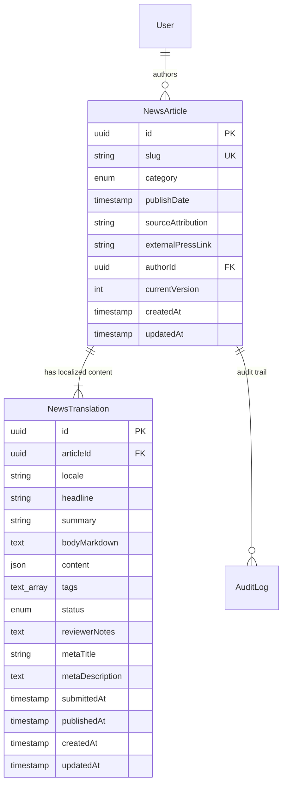
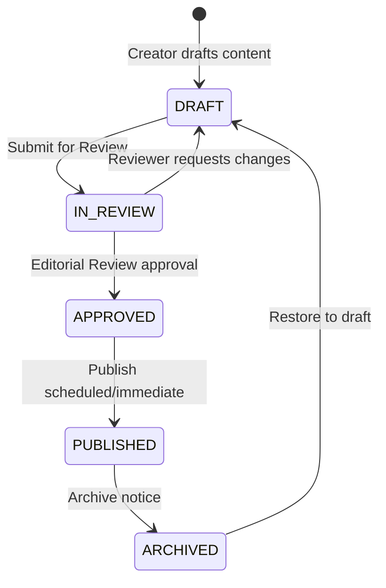

# Phase 5 — Content Module Pattern & Reusable Architecture

## 1. Executive Summary & Architecture Intent

This specification documents the shared, reusable content-management architecture for the **AIC-ADT Baramati Foundation CMS**. To ensure governance, institutional security, and consistency across all content types, this architecture establishes a uniform pattern for:
- Listing with pagination, search, and allowlisted sorting.
- Creating drafts with initial localized translations.
- Reading detailed records with versioning and author attribution.
- Editing content with record-level authorization and strict field isolation.
- Advancing records through the editorial review workflow (`DRAFT` → `IN_REVIEW` → `APPROVED` → `PUBLISHED` → `ARCHIVED`).
- Audit logging for all mutating operations.

The **News Articles & Press Announcements** module (`NewsArticle` and `NewsTranslation`) serves as the first fully verified, end-to-end reference implementation. Subsequent content modules (Programs, Startups, Events, Publications, and Pages) must adhere to the patterns codified in this document.

---

## 2. Reusable Domain Entity Structure

### 2.1 Separation of Core Identity and Localized Content

To support multi-lingual requirements (English and Marathi) without data duplication, content entities are structured into two complementary layers:



1. **Root Entity (`NewsArticle` / `<Entity>`):**
   - Holds stable, locale-invariant properties: UUID, unique URL slug, taxonomic category, official publication date, source attribution, and author reference (`authorId`).
   - Enforces relational referential integrity with `User` (`onDelete: Restrict`).
2. **Translation Entity (`NewsTranslation` / `<Entity>Translation`):**
   - Holds locale-specific properties (`locale`: `'en' | 'mr'`).
   - Contains headline, summary, structured content/markdown, metadata, and editorial workflow status.
   - Enforces unique constraint per entity and locale: `@@unique([articleId, locale])`.

### 2.2 Content Workflow State Machine

Editorial transitions are strictly decoupled from general content updating:



- **`DRAFT`:** Editable by the author or users with `CONTENT_PUBLISH` permission.
- **`IN_REVIEW`:** Locked for author editing while undergoing governance verification.
- **`APPROVED`:** Passed editorial verification; awaiting scheduled or immediate publication.
- **`PUBLISHED`:** Publicly visible on the production website.
- **`ARCHIVED`:** Removed from active listings; retained in statutory audit store.

---

## 3. Backend Implementation Architecture (NestJS & Prisma)

### 3.1 DTO Contracts and Anti-Mass-Assignment Guarantees

Every mutation uses explicit, validated DTOs. Direct updates via `UpdateNewsDto` **strictly omit the `status` field** to prevent unauthorized workflow state elevation.

| Operation | DTO | Validation Highlights |
| :--- | :--- | :--- |
| **Create** | `CreateNewsDto` | Required slug, category, publishDate, headline, summary. Slug regex `^[a-z0-9]+(?:-[a-z0-9]+)*$`. |
| **Update** | `UpdateNewsDto` | Partial fields. **No `status` property allowed.** |
| **List Query** | `QueryNewsDto` | `page` (min: 1), `limit` (max: 50), `locale`, `status`, `category`, `search`, allowlisted `sortBy`, `sortOrder`. |
| **Submit Review** | `SubmitReviewDto` | Optional `notes` field (max 1000 chars), `locale` parameter. |

### 3.2 Allowlisted Sorting & Safe Pagination

Client-supplied sorting is validated against explicit allowlists to prevent SQL injection and query denial-of-service:

```typescript
export const ALLOWED_NEWS_SORT_FIELDS = [
  'createdAt',
  'updatedAt',
  'publishDate',
  'slug',
] as const;
```

Pagination parameters default to `page = 1`, `limit = 10`, with hard maximum bounds of `50`. Offset calculations: `skip = (page - 1) * limit`.

### 3.3 Record-Level Authorization Matrix

Authorization is enforced at both route guard and service method levels:

| User Role | Read / List | Create Draft | Update Draft | Submit Review | Archive / Restore |
| :--- | :---: | :---: | :---: | :---: | :---: |
| **SUPER_ADMIN** | Yes | Yes | Yes (Any) | Yes | Yes |
| **ADMIN** | Yes | Yes | Yes (Any) | Yes | Yes |
| **EDITOR** | Yes | Yes | Yes (Own only) | Yes (Own only) | If permitted |
| **REVIEWER** | Yes | No | No | No | Reviewer only |
| **VIEWER** | Yes | No | No | No | No |

### 3.4 Append-Only Audit Trail

All lifecycle transitions invoke `AuditLog` logging within transaction scopes:
- `CREATE`: Record created by author.
- `UPDATE`: Content attributes updated.
- `SUBMIT_REVIEW`: Draft submitted into editorial queue.
- `ARCHIVE`: Record transitioned to archived state.
- `RESTORE`: Archived record restored to draft.

---

## 4. Frontend Admin Shell Architecture (Next.js)

### 4.1 Route Directory Structure

```
apps/web/src/
├── app/
│   └── admin/
│       └── news/
│           ├── page.tsx            # Live listing, filters, pagination, table
│           ├── new/
│           │   └── page.tsx        # Create draft and submit for review
│           └── [id]/
│               ├── page.tsx        # Detailed inspection, preview, status actions
│               └── edit/
│                   └── page.tsx    # Edit draft with change tracking
├── components/
│   └── admin/
│       └── content/
│           └── NewsArticleForm.tsx # Reusable form component with client validation
└── app/api/content/news/           # Next.js API proxy routes for authenticated forwarding
```

### 4.2 Reusable UI Component Patterns

1. **Search & Filter Toolbar:**
   - Text input for keyword search (matches headlines, slugs).
   - Category dropdown (taxonomic filtering).
   - Status dropdown (`DRAFT`, `IN_REVIEW`, `APPROVED`, `PUBLISHED`, `ARCHIVED`).
   - "Reset Filters" action button.
2. **Status Badges:**
   - Consistent semantic color styling across list and detail pages:
     - `DRAFT`: Amber badge (`bg-amber-950/60 text-amber-300 border-amber-800`).
     - `IN_REVIEW`: Blue badge (`bg-blue-950/60 text-blue-300 border-blue-800`).
     - `APPROVED`: Violet badge (`bg-purple-950/60 text-purple-300 border-purple-800`).
     - `PUBLISHED`: Emerald badge (`bg-emerald-950/60 text-emerald-300 border-emerald-800`).
     - `ARCHIVED`: Slate badge (`bg-slate-800 text-slate-400 border-slate-700`).
3. **Form Validation & Unsaved-Changes Warning:**
   - Real-time client-side checks for slug format, title length, and required summaries.
   - Navigation guard alerts the user if dirty form state exists prior to navigating away.
4. **Detail & Preview View:**
   - Tabs for previewing English and Marathi versions.
   - Metadata inspection sidebar displaying Author, Timestamps, Version counter, and Revision history.
   - Contextual actions: "Submit for Review" (for DRAFTs), "Archive" (for PUBLISHED), "Restore" (for ARCHIVED).

---

## 5. Recipe for Subsequent Content Modules

When implementing subsequent modules (Programs, Startups, Events, Publications, Pages), developers must replicate this exact pattern:

1. **Prisma Schema:** Add parent entity (`<Entity>`) and translation entity (`<Entity>Translation`).
2. **Constants:** Define `ALLOWED_<ENTITY>_SORT_FIELDS` and status enum mappings.
3. **DTOs:** Create `Create<Entity>Dto`, `Update<Entity>Dto` (no status field), `Query<Entity>Dto`, `SubmitReviewDto`.
4. **Service:** Implement CRUD + transition methods with slug uniqueness checks, author ownership guards, and audit trail generation.
5. **Controller:** Expose `/api/v1/content/<entities>` with `@UseGuards(SessionAuthGuard, PermissionsGuard)`.
6. **Web Proxy:** Add Next.js route handlers in `apps/web/src/app/api/content/<entities>/`.
7. **Web UI:** Build `<Entity>Form.tsx`, listing page, detail page, and edit page adhering to the admin shell layout.
8. **Automated Tests:** Add service unit tests, controller unit tests, and React component tests.
