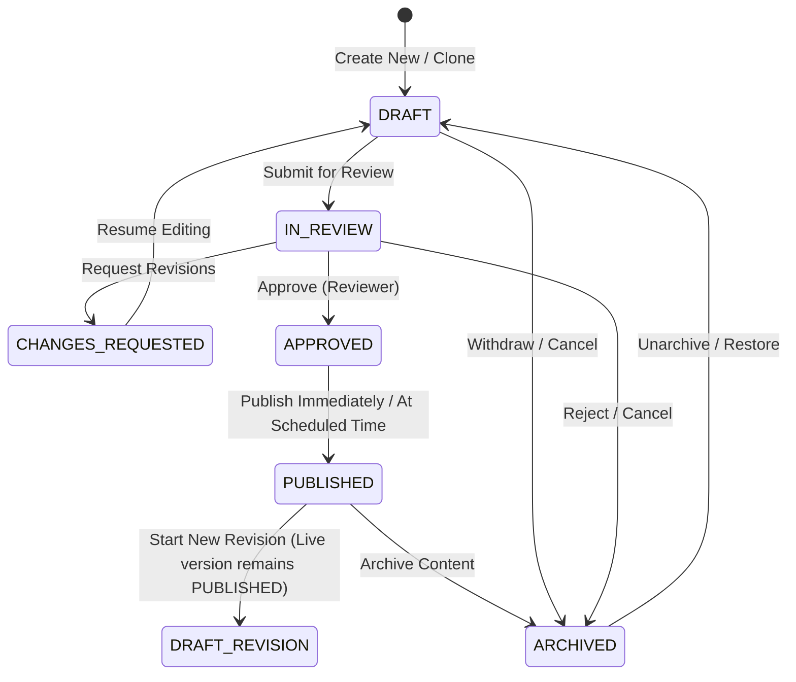

# Phase 5 Editorial Workflow & Lifecycle State Machine

**Project:** AIC-ADT Baramati Foundation Institutional Website  
**Phase:** Phase 5 — Content Management System & Editorial Workflows (Task 2)  
**Roles:** Editorial Director, Institutional Governance Lead, Principal Architect  
**Date:** October 12, 2026  
**Status:** **APPROVED EDITORIAL GOVERNANCE SPECIFICATION**  

---

## 1. Executive Summary

This document formalizes the publication lifecycle, permission rules, and state machine transitions for the AIC-ADT Baramati Foundation Content Management System.

Because AIC-ADT operates under institutional mandates from Atal Innovation Mission (NITI Aayog) and host institution Agricultural Development Trust (ADT) Baramati, public publications must conform to strict institutional integrity. **Self-approval is forbidden**, and **live published content must remain continuously accessible while editors stage new revisions**.

---

## 2. Permitted Lifecycle States & Transition Diagram



---

## 3. Transition Authority & Role-Based Permissions

Every state transition requires specific role credentials. An audit log entry is recorded with every change.

| From State | To State | Action Name | Authorized Roles | Preconditions & Validation |
| :--- | :--- | :--- | :--- | :--- |
| **(None)** | `DRAFT` | `CREATE` | `CONTENT_AUTHOR`, `CONTENT_EDITOR`, `PROGRAM_MANAGER`, `ADMIN` | Title and initial fields provided; slug verified unique. |
| `DRAFT` | `IN_REVIEW` | `SUBMIT_REVIEW` | `CONTENT_AUTHOR`, `CONTENT_EDITOR`, `PROGRAM_MANAGER`, `ADMIN` | All required fields populated; media assets attached; fact checklist acknowledged. |
| `IN_REVIEW` | `CHANGES_REQUESTED` | `REQUEST_CHANGES` | `CONTENT_EDITOR`, `APPROVER`, `REVIEWER`, `ADMIN` | Written reviewer notes detailing required corrections. |
| `IN_REVIEW` | `APPROVED` | `APPROVE` | `APPROVER`, `CONTENT_EDITOR`, `ADMIN` | **Dual-Custody Rule:** The approver **cannot be the same user** who authored or submitted the content. |
| `APPROVED` | `PUBLISHED` | `PUBLISH` | `CONTENT_EDITOR`, `ADMIN` | Publication timestamp set; triggers Next.js cache revalidation webhook. |
| `PUBLISHED` | `DRAFT_REVISION` | `BRANCH_REVISION` | `CONTENT_AUTHOR`, `CONTENT_EDITOR`, `PROGRAM_MANAGER`, `ADMIN` | Clones current state into a new `ContentRevision` staged draft; **live content remains published**. |
| `PUBLISHED` | `ARCHIVED` | `ARCHIVE` | `CONTENT_EDITOR`, `ADMIN` | Retires content from public index; updates sitemap. |
| `ARCHIVED` | `DRAFT` | `RESTORE` | `ADMIN` | Restores archived record to draft status for re-evaluation. |

---

## 4. Dual-Custody & Anti-Self-Approval Enforcement

To prevent rogue, accidental, or fraudulent publications:

```typescript
// Enforced in NestJS ReviewService before state transition:
if (currentUser.id === contentEntity.authorId && currentUser.role !== Role.ADMIN) {
  throw new ForbiddenException(
    'INSTITUTIONAL GOVERNANCE VIOLATION: Self-approval is strictly prohibited. Another authorized editor or reviewer must verify this content prior to approval.'
  );
}
```

Exceptions: Only the `ADMIN` role may bypass dual-custody for emergency hotfixes, and such actions generate a critical-severity `AuditLog` entry flagged for governance review.

---

## 5. Live Revision Staging (Zero Disruption to Published Content)

A major flaw in naive CMS architectures is that updating a published record immediately changes the public website or hides the live page while editing.

### The Staged Revision Mechanism
1. When a user clicks **"Edit Published Content"**, the system:
   - Increments the parent entity `currentVersion`.
   - Leaves the `StartupTranslation.status = PUBLISHED` completely untouched.
   - Creates a snapshot in `content_revisions` with `dataSnapshot` capturing the newly proposed edits in draft mode.
2. **Public Viewers:** Continue reading the live `PUBLISHED` record.
3. **Editors:** Work inside the draft revision interface.
4. **On Approval & Publish:**
   - The revision's snapshot is merged atomically into the active record within a PostgreSQL transaction.
   - `publishedAt` is refreshed.
   - Cache tag revalidation (`revalidateTag('startups')`) is dispatched.
   - The public website updates instantly with zero downtime.

---

## 6. Edge Cases & Exception Handling

### 6.1 Withdrawal
An author who has submitted content for review (`IN_REVIEW`) may withdraw their submission back to `DRAFT` at any time before an approval decision is rendered.

### 6.2 Scheduled Publication
When content is marked for a future publication date (e.g. an embargoed press release or intake announcement), its state is set to `APPROVED` with `publishDate = <future_timestamp>`. A scheduled background cron or worker evaluates `publishDate <= now()` and triggers the state change to `PUBLISHED` and executes CDN revalidation.

### 6.3 Failed Publication / Webhook Invalidation Retries
If Next.js cache revalidation fails following a publish event:
1. The database transaction committing the `PUBLISHED` state completes successfully.
2. The revalidation event is placed into a retry queue in PostgreSQL.
3. The system retries with exponential backoff up to 5 times.
