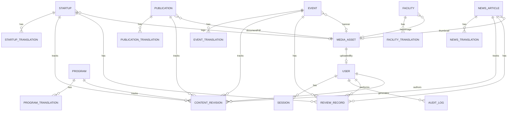

# Phase 5 Domain Model Architecture

**Project:** AIC-ADT Baramati Foundation Institutional Website  
**Phase:** Phase 5 — Content Management System & Editorial Workflows (Task 2)  
**Roles:** Enterprise Software Architect, Lead Backend Engineer  
**Date:** October 12, 2026  
**Status:** **DESIGN SPECIFICATION — APPROVED FOR IMPLEMENTATION**  

---

## 1. Executive Summary

This document specifies the domain model for the AIC-ADT Baramati Foundation Content Management System (CMS). The design balances institutional governance, role-based security, multilingual support (English and Marathi), revision history, and high-performance public delivery.

Rather than over-generalizing every domain into an untyped JSON document or duplicating boilerplate across disconnected tables, the architecture establishes a **typed relational core** where entities share common lifecycle contracts while maintaining domain-specific fields.

---

## 2. Entity Relationship Overview



---

## 3. Core Domain Entities Catalog

### 3.1 Identity & Access Entities

#### `User` (System User)
- **Purpose:** System users participating in administration, content authoring, review, or institutional governance.
- **Attributes:**
  - `id`: UUID (Primary Key)
  - `email`: VarChar(255) (Unique)
  - `fullName`: VarChar(150)
  - `phone`: VarChar(20) (Optional)
  - `passwordHash`: VarChar(255) (Argon2id / Bcrypt)
  - `role`: Enum (`ADMIN`, `CONTENT_EDITOR`, `CONTENT_AUTHOR`, `PROGRAM_MANAGER`, `APPROVER`, `REVIEWER`, `PUBLIC_APPLICANT`)
  - `status`: Enum (`ACTIVE`, `INACTIVE`, `SUSPENDED`, `PENDING_VERIFICATION`)
  - `createdAt`, `updatedAt`: Timestamptz(6)

#### `Session` (Server-Side Authenticated Session)
- **Purpose:** Manages active user sessions in compliance with ADR-008.
- **Attributes:**
  - `id`: UUID (Primary Key)
  - `userId`: UUID (FK $\to$ `User.id`, `ON DELETE CASCADE`)
  - `tokenHash`: VarChar(255) (SHA-256 hash of random session token)
  - `expiresAt`: Timestamptz(6)
  - `ipAddress`: VarChar(45)
  - `userAgent`: Text
  - `createdAt`: Timestamptz(6)

---

### 3.2 Content Domain Entities

#### `Startup` & `StartupTranslation` (Startup Ecosystem Directory)
- **Purpose:** Incubated agritech, biotechnology, and rural innovation ventures.
- **Parent (`Startup`):**
  - Canonical identifier, sector (`AGRI_TECH`, `SMART_FARMING`, `BIOTECHNOLOGY`, `FOOD_PROCESSING`, `CLIMATE_TECH`, `AGRIBUSINESS`), cohort identifier, funding scheme, founding team, location coordinates, TRL level (`TRL_1` through `TRL_9`), lab usage references, verified boolean flag, homepage featured flag, logo asset reference (`logoAssetId`), external website URL.
- **Translation (`StartupTranslation`):**
  - Locale (`en` / `mr`), localized startup name, localized tagline, detailed overview, problem statement, innovative solution, reach/impact metric, milestone achievements, publication status (`DRAFT`, `IN_REVIEW`, `APPROVED`, `PUBLISHED`, `ARCHIVED`).

#### `Event` & `EventTranslation` (Workshops, Hackathons, Conclaves)
- **Purpose:** Incubation calls, masterclasses, and field demonstration events.
- **Parent (`Event`):**
  - Canonical slug, category (`INTAKE_DEADLINE`, `TECHNICAL_WORKSHOP`, `FIELD_SHOWCASE`, `ECOSYSTEM_CONCLAVE`, `TRAINING_BOOTCAMP`), start date/time, end date/time, venue type (`IN_PERSON`, `ONLINE`, `HYBRID`), venue coordinates, organizer, registration deadline, registration URL, external registration flag, banner asset ID.
- **Translation (`EventTranslation`):**
  - Locale (`en` / `mr`), localized title, short description, full description paragraphs, venue display name and address, target audience labels, publication status.

#### `NewsArticle` & `NewsTranslation` (Official Press & Announcements)
- **Purpose:** Institutional press releases, funding approvals, and MoUs.
- **Parent (`NewsArticle`):**
  - Canonical slug, publication date (supports embargoed releases), category (`OFFICIAL_ANNOUNCEMENT`, `FUNDING_MILESTONE`, `INFRASTRUCTURE`, `ECOSYSTEM_PARTNERSHIP`), external media URL, source attribution, thumbnail asset ID.
- **Translation (`NewsTranslation`):**
  - Locale (`en` / `mr`), localized headline, summary, content body paragraphs, tags, key facts array (`[{ label, value }]`), publication status.

#### `Publication` & `PublicationTranslation` (Statutory & Research Documents)
- **Purpose:** Annual progress reports, scientific whitepapers, program manuals, and audited disclosures.
- **Parent (`Publication`):**
  - Canonical slug, category (`ANNUAL_REPORT`, `RESEARCH_WHITEPAPER`, `PROGRAM_GUIDELINE`, `POLICY_COMPLIANCE`, `BRAND_ASSET`), reporting period (e.g., `"FY 2024-25"`), publication date, statutory requirement flag, PDF document asset reference (`documentAssetId`), file size in bytes, total page count.
- **Translation (`PublicationTranslation`):**
  - Locale (`en` / `mr`), localized title, executive summary, key highlight bullet points, issuing authority name, verification badge text, publication status.

#### `Program` & `ProgramTranslation` (Incubation & Acceleration Offerings)
- **Purpose:** Official incubation tracks and government scheme landing records.
- **Parent (`Program`):**
  - Canonical slug, program type (`CORE_PROGRAM`, `FUNDING_SCHEME`), development stage focus, duration in months, TRL target range, application status (`ACTIVE_INTAKE`, `ROLLING_REVIEW`, `UPCOMING_CALL`), application URL.
- **Translation (`ProgramTranslation`):**
  - Locale (`en` / `mr`), localized program name, tagline, summary, target audience list, core offerings, eligibility criteria, selection process steps, funding scope description, publication status.

#### `Facility` & `FacilityTranslation` (Labs & Incubation Infrastructure)
- **Purpose:** Specialized laboratories (Soil & Water NABL Lab, IoT & Drone Testing, Biotech Incubation).
- **Parent (`Facility`):**
  - Canonical slug, accreditation ID (e.g., `"TC-8241"`), equipment catalog JSON, lab in-charge contact officer details, hero image asset reference.
- **Translation (`FacilityTranslation`):**
  - Locale (`en` / `mr`), localized name, tagline, description, key capabilities list, booking instructions, publication status.

---

### 3.3 Media & Document Entities

#### `MediaAsset` (Digital Asset Store)
- **Purpose:** Managed image, SVG, and PDF files.
- **Attributes:**
  - `id`: UUID (Primary Key)
  - `filename`: VarChar(255) (Unique storage filename)
  - `originalName`: VarChar(255)
  - `mimeType`: VarChar(100) (Restricted allowlist: `image/jpeg`, `image/png`, `image/webp`, `image/svg+xml`, `application/pdf`)
  - `fileSizeBytes`: BigInt
  - `storagePath`: VarChar(500)
  - `isPrivate`: Boolean (Public downloadable vs. confidential review documents)
  - `altText`: VarChar(255) (Accessibility compliance)
  - `caption`: VarChar(255) (Optional)
  - `checksumSha256`: VarChar(64) (Integrity verification)
  - `uploadedById`: UUID (FK $\to$ `User.id`, `ON DELETE SET NULL`)
  - `createdAt`: Timestamptz(6)

---

### 3.4 Governance, Versioning & Audit Entities

#### `ContentRevision` (Immutable Version Snapshots)
- **Purpose:** Staged historical snapshots allowing editors to prepare new versions without overwriting published content.
- **Attributes:**
  - `id`: UUID (Primary Key)
  - `entityType`: VarChar(50) (`STARTUP`, `EVENT`, `NEWS`, `PUBLICATION`, `PROGRAM`, `FACILITY`)
  - `entityId`: UUID
  - `versionNumber`: Integer
  - `locale`: VarChar(5) (`en`, `mr`)
  - `dataSnapshot`: JSONB (Complete snapshot of translated and common fields)
  - `authorId`: UUID (FK $\to$ `User.id`)
  - `changeSummary`: VarChar(255)
  - `createdAt`: Timestamptz(6)

#### `ReviewRecord` (Formal Approval Audit Trail)
- **Purpose:** Records peer reviews, legal compliance sign-offs, and editorial decisions.
- **Attributes:**
  - `id`: UUID (Primary Key)
  - `entityType`: VarChar(50)
  - `entityId`: UUID
  - `locale`: VarChar(5)
  - `revisionId`: UUID (FK $\to$ `ContentRevision.id`)
  - `reviewerId`: UUID (FK $\to$ `User.id`)
  - `decision`: Enum (`APPROVED`, `CHANGES_REQUESTED`, `REJECTED`)
  - `reviewNotes`: Text
  - `createdAt`: Timestamptz(6)

#### `AuditLog` (Append-Only System Audit Log)
- **Purpose:** Comprehensive compliance logging of all authentication events, administrative actions, and data mutations.
- **Attributes:**
  - `id`: UUID (Primary Key)
  - `userId`: UUID (Nullable, FK $\to$ `User.id`)
  - `action`: VarChar(100)
  - `resource`: VarChar(100)
  - `resourceId`: VarChar(255)
  - `ipAddress`: VarChar(45)
  - `userAgent`: Text
  - `metadata`: JSONB
  - `createdAt`: Timestamptz(6)

---

## 4. Common Metadata & Lifecycle Contracts

To maintain engineering consistency, all domain models implement standardized interface contracts in application code:

```typescript
export interface IAuditableEntity {
  id: string;
  createdAt: Date;
  updatedAt: Date;
}

export interface IVersionedEntity extends IAuditableEntity {
  currentVersion: number;
  publishedVersion?: number | null;
}

export interface ITranslatableEntity<TTranslation> extends IVersionedEntity {
  slug: string;
  translations: TTranslation[];
}

export interface ITranslationContent {
  id: string;
  locale: 'en' | 'mr';
  status: 'DRAFT' | 'IN_REVIEW' | 'CHANGES_REQUESTED' | 'APPROVED' | 'PUBLISHED' | 'ARCHIVED';
  publishedAt?: Date | null;
  archivedAt?: Date | null;
}
```
