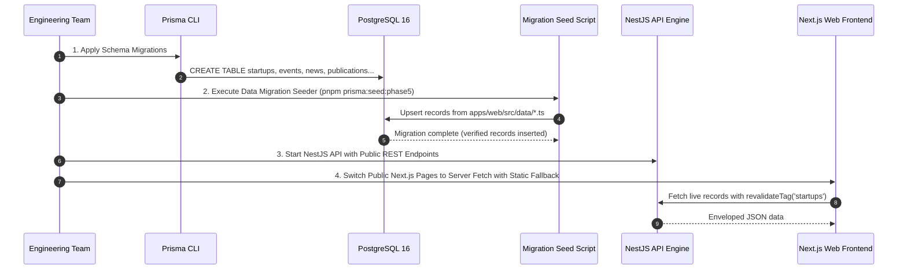

# Phase 5 Existing Content Migration Plan & Strategy

**Project:** AIC-ADT Baramati Foundation Institutional Website  
**Phase:** Phase 5 — Content Management System & Editorial Workflows (Task 1)  
**Roles:** Data Architect, Lead Backend Engineer, Lead Frontend Engineer  
**Date:** October 12, 2026  
**Status:** **MIGRATION RUNBOOK APPROVED — READY FOR SEEDING SCRIPT IMPLEMENTATION**  

---

## 1. Executive Summary

During Phase 4, the public website was built with 77 static routes consuming typed, verified TypeScript datasets located in `apps/web/src/data/*.ts`. This design decoupled presentation markup from content while maintaining a strict Fact-First Truthfulness standard.

This document establishes the **Content Migration Plan** to transition these static datasets into PostgreSQL 16 database tables managed by Prisma and NestJS in Phase 5. The migration guarantees:
1. **Zero Data Loss:** 100% of verified Phase 4 facts, metrics, and biographies are preserved.
2. **Zero Downtime:** Next.js Incremental Static Regeneration (ISR) and static pre-rendering fallbacks ensure public routes remain accessible even during API cold starts.
3. **Idempotent Execution:** Database migration and seeding scripts can be re-run safely without creating duplicate records.

---

## 2. Inventory of Hardcoded Static Data Sources

The following table maps every existing static data file in `apps/web/src/data/` to its corresponding target database entity in Prisma:

| Existing Source File | Lines / Size | Existing Exported Records | Target PostgreSQL Table | Public Routes Dependent |
| :--- | :--- | :--- | :--- | :--- |
| [apps/web/src/data/startups.ts](file:///Users/kuldeeplakhera/ADT/Projects/AIC-ADT/apps/web/src/data/startups.ts) | 262 lines | 6 cohort startups (`Gramheet`, `Innosapien`, `KrishiSense`, `DroneRaksha`, `BioCrop-Shield`, `AgriFresh ColdChain`) | `startups` | `/startups`<br>`/startups/[slug]`<br>`/startups/success-stories`<br>`/mr/startups` |
| [apps/web/src/data/events.ts](file:///Users/kuldeeplakhera/ADT/Projects/AIC-ADT/apps/web/src/data/events.ts) | 240 lines | 6 events (4 upcoming, 2 concluded) | `events` | `/events`<br>`/events/[slug]`<br>`/events/past`<br>`/mr/events` |
| [apps/web/src/data/news.ts](file:///Users/kuldeeplakhera/ADT/Projects/AIC-ADT/apps/web/src/data/news.ts) | 120 lines | 4 news articles / press releases | `news_articles` | `/news`<br>`/news/[slug]` |
| [apps/web/src/data/publications.ts](file:///Users/kuldeeplakhera/ADT/Projects/AIC-ADT/apps/web/src/data/publications.ts) | 165 lines | 8 publications across 4 categories | `publications` | `/resources`<br>`/resources/*`<br>`/mr/resources` |
| [apps/web/src/data/programs.ts](file:///Users/kuldeeplakhera/ADT/Projects/AIC-ADT/apps/web/src/data/programs.ts) | 360 lines | 7 core incubation programs + 3 government funding schemes | `programs` | `/programs`<br>`/programs/*`<br>`/programs/schemes/*`<br>`/mr/programs` |
| [apps/web/src/data/innovation.ts](file:///Users/kuldeeplakhera/ADT/Projects/AIC-ADT/apps/web/src/data/innovation.ts) | 310 lines | 6 research domains + 4 technology pilots | `innovation_domains`<br>`innovation_showcases` | `/innovation`<br>`/innovation/*`<br>`/mr/innovation` |
| [apps/web/src/data/institutional.ts](file:///Users/kuldeeplakhera/ADT/Projects/AIC-ADT/apps/web/src/data/institutional.ts) | 680 lines | 5 facilities, 7 leadership team members, 5 governing council members, 6 milestones | `facilities`<br>`leadership_members`<br>`milestones` | `/about`<br>`/about/leadership`<br>`/about/mission-vision`<br>`/about/partners`<br>`/about/infrastructure/*`<br>`/mr/about` |
| [apps/web/src/data/contact.ts](file:///Users/kuldeeplakhera/ADT/Projects/AIC-ADT/apps/web/src/data/contact.ts) | 90 lines | 5 department desks, campus transit routes | `department_desks`<br>`system_settings` | `/contact`<br>`/contact/directions`<br>`/contact/partnerships`<br>`/mr/contact` |
| [apps/web/src/data/homepage.ts](file:///Users/kuldeeplakhera/ADT/Projects/AIC-ADT/apps/web/src/data/homepage.ts) | 150 lines | Hero metrics, focus pillars, featured programs | `system_settings` | `/`<br>`/mr` |

---

## 3. Migration Execution Procedure



### Step 1: Schema Migration in Prisma
Create and apply the relational schema migration in `apps/api/prisma/schema.prisma` defining all domain tables, indexes, constraints, and foreign keys:
```bash
pnpm --filter @aic/api exec prisma migrate dev --name add_cms_domain_models
```

### Step 2: Automated Idempotent Data Seeder
Implement a dedicated migration seed script (`apps/api/prisma/seeds/content-migration.seed.ts`) that imports the exact data objects from the verified repository state and executes `upsert` queries:

```typescript
// Sample Idempotent Seeder Pattern
for (const startup of COHORT_STARTUPS) {
  await prisma.startup.upsert({
    where: { slug: startup.slug },
    update: {
      name: startup.name,
      tagline: startup.tagline,
      sector: mapSector(startup.sector),
      cohort: startup.cohort,
      fundingScheme: startup.fundingScheme,
      founders: startup.founders,
      location: startup.location,
      overview: startup.overview,
      problemStatement: startup.problemStatement,
      solutionInnovation: startup.solutionInnovation,
      reachMetric: startup.reachMetric,
      labsUsed: startup.labsUsed,
      trlLevel: startup.trlLevel,
      milestones: startup.milestones,
      websiteUrl: startup.websiteUrl,
      verified: startup.verified,
      featuredInHomepage: startup.featuredInHomepage,
      status: 'PUBLISHED',
    },
    create: { ...startupData, status: 'PUBLISHED' },
  });
}
```

### Step 3: Verification Script & Checksum Audit
An automated verification script compares database query counts against the source arrays:
- `startups`: Expecting exactly 6 records.
- `events`: Expecting exactly 6 records (4 upcoming, 2 concluded).
- `news`: Expecting exactly 4 records.
- `publications`: Expecting exactly 8 records.
- `facilities`: Expecting exactly 5 records.
- `programs`: Expecting exactly 10 records (7 programs + 3 schemes).

---

## 4. Transition & Fallback Strategy for Public Frontend

To prevent breaking the 77 statically pre-rendered routes during the transition to dynamic API delivery:

1. **Dual-Mode Data Provider (`getStartups()`, `getEvents()`, etc.):**
   Implement data access utilities in `apps/web/src/lib/api/` with automatic fallback:
   ```typescript
   export async function getStartups(): Promise<StartupProfile[]> {
     try {
       const res = await fetch(`${process.env.INTERNAL_API_URL}/api/v1/public/startups`, {
         next: { tags: ['startups'], revalidate: 3600 },
       });
       if (!res.ok) throw new Error(`API error ${res.status}`);
       const json = await res.json();
       return json.data;
     } catch (error) {
       console.warn('API unavailable, falling back to verified static data:', error);
       return COHORT_STARTUPS; // Verified static fallback
     }
   }
   ```
2. **On-Demand Cache Invalidation:**
   When an administrator edits a startup in the CMS, NestJS dispatches a cache revalidation webhook to Next.js (`POST /api/revalidate?tag=startups&secret=...`), instantly updating the public static page without rebuilding the entire application.
3. **Rollback Safety:**
   The static data files in `apps/web/src/data/` will remain permanently committed in the codebase as an offline fallback and fixture library for unit tests.
