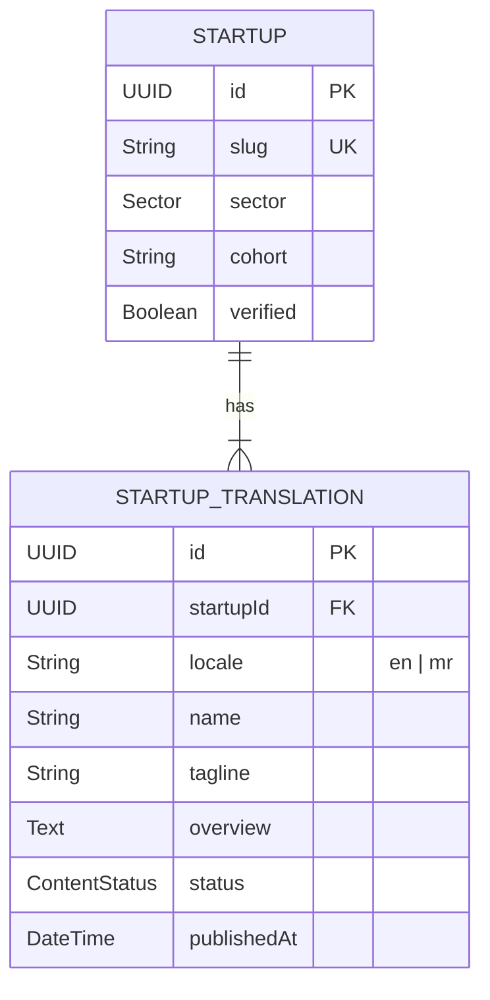

# Phase 5 Bilingual Localization Model & Architecture

**Project:** AIC-ADT Baramati Foundation Institutional Website  
**Phase:** Phase 5 — Content Management System & Editorial Workflows (Task 2)  
**Roles:** Enterprise Architect, Lead Frontend Engineer, Localization Specialist  
**Date:** October 12, 2026  
**Status:** **APPROVED ARCHITECTURAL DECISION — PARENT-TRANSLATION MODEL**  

---

## 1. Architectural Approach Evaluation

To manage bilingual content (English and Marathi) across the 77 public website routes and administrative interfaces, two architectural paradigms were evaluated:

### Approach A: Sibling Records with Shared Content Identity
In this model, an English news article and a Marathi news article are separate rows in the same table, linked together by an abstract `contentGroupId` or `translationKey`.

- **Pros:** Table structure is flat and uniform.
- **Cons:** Shared metadata (e.g., event dates, venue coordinates, startup funding schemes, PDF file references, TRL levels) is duplicated across sibling rows. Updating the start date of an event requires mutating multiple rows, creating a severe risk of synchronization drift.

### Approach B: Parent Content Entity with Sub-Records (Selected)
In this model, a parent table (`startups`, `events`, `news_articles`, etc.) stores language-agnostic operational metadata (UUID, canonical slug, dates, numeric metrics, foreign keys to media assets), while a dedicated child table (`startup_translations`, `event_translations`, etc.) stores text, rich paragraphs, and translation lifecycle status (`locale: 'en' | 'mr'`).

- **Pros:**
  1. **Single Source of Truth for Facts:** Dates, event schedules, coordinates, and accreditations exist in exactly one place.
  2. **Independent Translation Lifecycles:** An English article can be published on Monday, while the Marathi translation remains in `DRAFT` or `IN_REVIEW` without blocking the English release.
  3. **Strict Fallback Traceability:** Missing translations can be queried with a simple `LEFT JOIN` where `translation.locale = 'mr' IS NULL`.
- **Decision:** **Adopt Approach B (Parent Content Record with Related Localized Records)** as the foundational architecture for all translatable CMS domains.

---

## 2. Relational Schema Representation



Every domain follows the composite uniqueness constraint:
```prisma
@@unique([parentId, locale], name: "uq_<domain>_translations_locale")
```
This guarantees that a parent entity can never have more than one active record for a given language.

---

## 3. Translation Lifecycle States

Translations move through an independent editorial state machine:

| Status | Meaning | Public Visibility |
| :--- | :--- | :--- |
| **`DRAFT`** | Author is drafting or modifying the text. | Hidden from public visitors. |
| **`IN_REVIEW`** | Submitted to Chief Translator / Editorial Committee. | Hidden from public visitors. |
| **`CHANGES_REQUESTED`**| Reviewer flagged grammatical or terminological flaws. | Hidden from public visitors. |
| **`APPROVED`** | Certified by bilingual reviewer; ready for release. | Hidden from public visitors. |
| **`PUBLISHED`** | Live and indexed by search engines. | Visible on respective locale route. |
| **`ARCHIVED`** | Retired or superseded by a newer statutory release. | Hidden from standard public listings. |

---

## 4. Truthfulness & Fallback Protocol

> [!CAUTION]
> **Strict Fact-First Compliance Rule:**  
> Never silently display English content on a Marathi route while labeling or presenting it as Marathi. Masquerading untranslated text breaches digital accessibility guidelines and deceives citizens.

When a public visitor navigates to a Marathi route (e.g., `/mr/startups/krishisense` or `/mr/events/sisfs-cohort-4`) where the Marathi translation is either missing or still in `DRAFT`:

1. **Structured Fallback Detection:**
   The API returns an explicit fallback payload:
   ```json
   {
     "success": true,
     "statusCode": 200,
     "data": {
       "canonicalSlug": "krishisense",
       "locale": "en",
       "isFallback": true,
       "translationStatus": "mr_pending",
       "title": "KrishiSense Technologies",
       "overview": "IoT automated soil telemetry system..."
     }
   }
   ```
2. **Prominent User Advisory:**
   The frontend renders an official institutional notification banner above the content:
   > **सूचना (Advisory):** या पृष्ठाचे अधिकृत मराठी भाषांतर अद्याप पुनरावलोकनाधीन आहे. नागरिकांच्या सोयीसाठी तात्पुरती मूळ इंग्रजी माहिती खाली दर्शविली आहे.  
   > *(Notice: The official Marathi translation for this page is currently under review. For citizen convenience, the original English information is displayed below.)*
3. **HTTP Metadata:**
   The response sets `<html lang="en">` for that content block and retains `hreflang="en"` links to prevent search engine indexing of pseudo-Marathi pages.

---

## 5. Technical SEO & Alternate Linking

For every translatable entity, the public website generates bidirectional `<link rel="alternate">` tags in the HTML `<head>`:

```html
<link rel="canonical" href="https://aic-adt.org/startups/krishisense" />
<link rel="alternate" hreflang="en" href="https://aic-adt.org/startups/krishisense" />
<link rel="alternate" hreflang="mr" href="https://aic-adt.org/mr/startups/krishisense" />
<link rel="alternate" hreflang="x-default" href="https://aic-adt.org/startups/krishisense" />
```

If the Marathi translation is not yet in `PUBLISHED` status, the Marathi `hreflang` link is excluded from the sitemap and HTML header until formal approval is granted.
