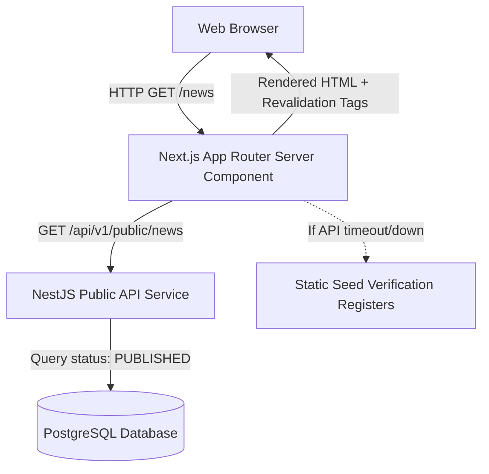

# Phase 5 — Public Content Integration Architecture

This document defines how the AIC-ADT Baramati Foundation Next.js public website integrates with the CMS Content APIs, covering server-side rendering, localization, empty and loading states, and resilient fallback mechanisms.

---

## 1. Integration Model Overview

The public website utilizes Next.js App Router Server Components to fetch content directly from the NestJS Public Content API (`/api/v1/public/*`).

---

## 2. Server-Side Content Fetcher Architecture

A centralized helper module (`apps/web/src/lib/api/public-content.ts`) encapsulates all public API calls, guaranteeing:

1. **Tag-Based Revalidation**: Every request injects relevant Next.js cache tags (e.g. `['news', 'news-en']`, `['events', 'events-en']`) enabling precision on-demand cache invalidation.
2. **Resilient Seed Fallback**: If the API backend is unreachable, times out, or encounters a disconnected database, the fetcher degrades gracefully to the verified institutional seed registers (`NEWS_ARTICLES`, `EVENTS_DATA`, `VERIFIED_STARTUPS_DIRECTORY`, `PROGRAMS_CONTINUUM`, `PUBLICATIONS_DATA`). This prevents downtime or build errors.
3. **Field Normalization**: Unifies API JSON models into the component prop contracts expected by the UI design system (`EventItem`, `NewsArticle`, `StartupProfile`).

---

## 3. Public Routes & Content Binding

| Route | Primary Content Source | Fallback Register | Localized Mirror |
| :--- | :--- | :--- | :--- |
| `/news` | `getPublishedNews('en')` | `NEWS_ARTICLES` | N/A (English press register) |
| `/news/[slug]` | `getPublishedNewsBySlug(slug, 'en')` | `NEWS_ARTICLES.find(slug)` | N/A |
| `/events` | `getPublicEvents('en')` | `EVENTS_DATA` | `/mr/events` |
| `/events/[slug]`| `getPublicEventBySlug(slug, 'en')` | `EVENTS_DATA.find(slug)` | `/events/[slug]` (English) |
| `/mr/events` | Curated Marathi event register / `getPublicEvents('mr')` | Curated Marathi events | `/events` |
| `/startups` | `getPublicStartups()` | `VERIFIED_STARTUPS_DIRECTORY` | `/mr/startups` |
| `/programs` | `getPublicPrograms('en')` | `PROGRAMS_CONTINUUM` | `/mr/programs` |
| `/resources` | `getPublicPublications()` | `PUBLICATIONS_DATA` | `/mr/resources` |

---

## 4. Localization Strategy (English & Marathi)

1. **Explicit Route Strategy**:
   - English routes reside at the root path (`/`, `/about`, `/news`, `/events`, etc.).
   - Marathi routes reside under the `/mr` prefix (`/mr`, `/mr/about`, `/mr/events`, etc.).
2. **Translation Verification**:
   - The public website strictly requests content for the active locale (`?locale=en` or `?locale=mr`).
   - If an approved Marathi translation does not exist for an article or event, the system does NOT silently display English text under a Marathi label.
   - When a user on a Marathi route requests a record with no published Marathi translation, the interface explicitly displays an editorial fallback notice with a clear link to the English document (e.g., *"संपूर्ण इंग्रजी दिनदर्शिका व तपशीलवार माहितीसाठी: Full English Record →"*).
3. **Bilingual Navigation**:
   - Language toggles in the primary navbar preserve route context where equivalent translations exist or route to the parent hub when a specific record is untranslated.

---

## 5. UI States & Resilient Presentation

### 5.1 Loading States
- Server Components utilize Next.js `loading.tsx` Suspense boundaries featuring animated skeleton loaders styled with Tailwind tokens (`bg-[#E8F0EB] animate-pulse`).

### 5.2 Empty States
- When a search, category filter, or query returns 0 published items, the UI presents an accessible, non-broken empty state:
  - Clear descriptive heading (e.g., *"No upcoming events found for this filter"*).
  - Explanatory guidance and a clear call-to-action button to reset filters or contact the incubation cell.

### 5.3 Error States
- If an unhandled exception occurs during client-side hydration, `error.tsx` catches the failure, presents an institutional recovery dialog, and allows users to retry or navigate back to the homepage.

---

## 6. Editorial Previews vs Public Isolation

- **Zero Draft Leakage**: Public endpoints only ever return `status = 'PUBLISHED'`.
- **Authorized Previews**: Editors previewing pending revisions or drafts utilize authenticated administrative preview routes (`/admin/news/preview/:id`, `/admin/events/preview/:id`) protected by `SessionAuthGuard` and `RequirePermissions`.
- **No Shared Caches**: Authenticated preview responses are explicitly configured with `Cache-Control: private, no-store, max-age=0` to ensure preview HTML is never cached at shared edge nodes.
