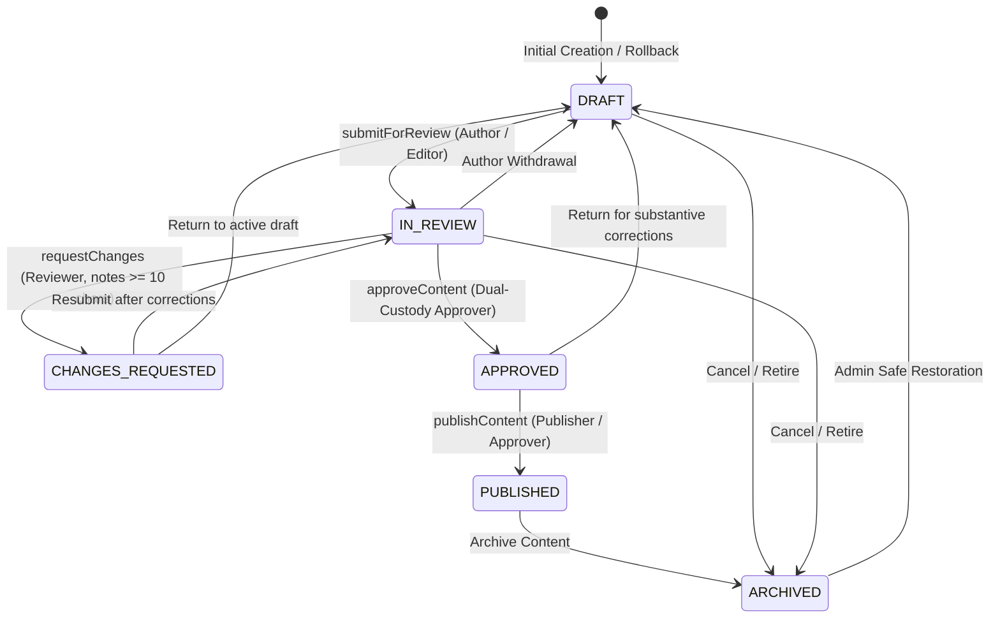

# Phase 5: Publishing Workflow & Editorial State Machine Architecture

**Project:** AIC-ADT Baramati Foundation Institutional Website  
**Phase:** Phase 5 — Content Management System & Editorial Workflows (Task 7)  
**Status:** Approved & Implemented  
**Date:** October 12, 2026  

---

## 1. Executive Summary

This architecture specification details the editorial workflow engine implemented for the AIC-ADT Baramati Foundation Content Management System. Because AIC-ADT operates under institutional oversight from Atal Innovation Mission (NITI Aayog) and the Agricultural Development Trust (ADT) Baramati, public publications demand rigorous dual-custody governance, immutable change tracking, and strict non-repudiation.

The publishing workflow enforces:
1. **Explicit Lifecycle State Machine**: Deterministic transitions across approved states (`DRAFT`, `IN_REVIEW`, `CHANGES_REQUESTED`, `APPROVED`, `PUBLISHED`, `ARCHIVED`).
2. **Dual-Custody & Anti-Self-Approval**: Content authors are categorically forbidden from approving or self-publishing their own work.
3. **Actionable Review Feedback**: Reviewers requesting changes must supply constructive notes ($\ge 10$ characters).
4. **Optimistic Concurrency Control**: Prevents stale revisions from overwriting concurrently updated records.
5. **Zero-Disruption Revision Staging**: Editing live published content branches a safe draft revision without degrading public page availability.

---

## 2. Permitted Editorial State Transitions

Arbitrary client-supplied status changes are strictly rejected by the backend NestJS `WorkflowService`. Any illegal transition returns an HTTP `409 ConflictException` detailing the permitted next states.



### Transition Authority & Preconditions Matrix

| From State | Target State | Action Name | Required Permission | Preconditions & Enforcements |
| :--- | :--- | :--- | :--- | :--- |
| `DRAFT` | `IN_REVIEW` | `WORKFLOW_SUBMIT_REVIEW` | `CONTENT_SUBMIT_REVIEW` | Title/headline populated; locale verified (`en` or `mr`). Snapshot stored in `content_revisions`. |
| `IN_REVIEW` | `CHANGES_REQUESTED` | `WORKFLOW_REQUEST_CHANGES` | `CONTENT_REVIEW` | Mandatory `reviewerNotes` with at least 10 characters detailing necessary corrections. |
| `IN_REVIEW` | `APPROVED` | `WORKFLOW_APPROVE` | `CONTENT_APPROVE` | **Dual-Custody Enforcement:** `currentUser.id !== entity.authorId`. If same author, rejected unless `ADMIN` emergency override with critical audit event. |
| `IN_REVIEW` | `DRAFT` | `WORKFLOW_WITHDRAW_REVIEW` | `CONTENT_SUBMIT_REVIEW` | Allowed for original author before an approval decision is rendered. |
| `CHANGES_REQUESTED` | `IN_REVIEW` | `WORKFLOW_SUBMIT_REVIEW` | `CONTENT_SUBMIT_REVIEW` | Corrections addressed; reviewer notes preserved in audit history. |
| `APPROVED` | `PUBLISHED` | `WORKFLOW_PUBLISH` | `CONTENT_PUBLISH` | Must be `APPROVED`; `expectedVersion === currentVersion` (concurrency check); title and required fields validated; updates `publishedAt`. |
| `PUBLISHED` | `DRAFT` (Branched) | `WORKFLOW_BRANCH_REVISION` | `CONTENT_UPDATE` | Increments version counter; stores staged revision draft; **live published record remains online**. |
| `PUBLISHED` | `ARCHIVED` | `WORKFLOW_ARCHIVE` | `CONTENT_ARCHIVE` | Retires content from public portal index. |
| `ARCHIVED` | `DRAFT` | `WORKFLOW_RESTORE` | `ADMIN` | Safe restoration to draft state for re-vetting. |

---

## 3. Dual-Custody & Anti-Self-Approval Enforcement

Under AIM and institutional compliance directives, no individual may unilaterally draft and publish public content without independent peer vetting:

```typescript
// Enforced in apps/api/src/workflow/workflow.service.ts
const isSelfAuthor = Boolean(entity.authorId && entity.authorId === currentUser.id);

if (isSelfAuthor && currentUser.role !== Role.ADMIN) {
  throw new ForbiddenException(
    'INSTITUTIONAL GOVERNANCE VIOLATION: Self-approval is strictly prohibited. Another authorized editor or reviewer must verify this content prior to approval.',
  );
}
```

### Emergency Override Governance
- If an `ADMIN` must approve an emergency hotfix where they were also the creator, the action is flagged as `WORKFLOW_APPROVE_ADMIN_OVERRIDE` in `audit_logs` with `{ overrideReason: 'EMERGENCY_ADMIN_SELF_APPROVAL_OVERRIDE' }`.
- Such events generate high-visibility alerts for the Executive Committee quarterly compliance review.

---

## 4. Pre-Publication Integrity Checks

Prior to transitioning content to `PUBLISHED`:
1. **Approval Verification**: Target content must currently reside in `APPROVED` status.
2. **Revision Alignment**: The approved revision snapshot must match the active record version.
3. **Field Completeness**: Required localized fields (Headline/Title, Summary/Short Description, Content/Full Description) must be non-empty.
4. **Optimistic Concurrency**: If the client supplies `expectedVersion`, it must equal `currentVersion`. Mismatches throw HTTP `409 ConflictException`.
5. **Slug Uniqueness**: Public slug must remain unique across the entity collection.
6. **Publication Timestamping**: Sets `publishedAt = CURRENT_TIMESTAMP` and appends immutable published revision to `content_revisions`.

---

## 5. Scope Decision: Scheduled Publishing

**Scope Status:** **DEFERRED TO FUTURE SCOPE**

### Rationale:
- In the current phase, immediate publishing upon dual-custody approval meets all statutory institutional requirements.
- Scheduled publishing requires a persistent background distributed scheduler (e.g. BullMQ with Redis or pg-boss with PostgreSQL) with idempotent worker execution, dead-letter retries, and time-zone-aware publication triggers.
- In-browser or client-tab timers are strictly prohibited by AIC-ADT engineering standards because browser closing leads to silent publication failures.
- Scheduled publishing will be implemented in Phase 6 as a dedicated cron/queue worker service once Redis/queue infrastructure is provisioned in the staging environment.
