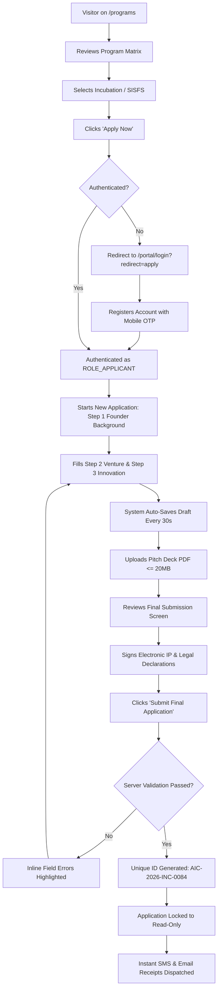
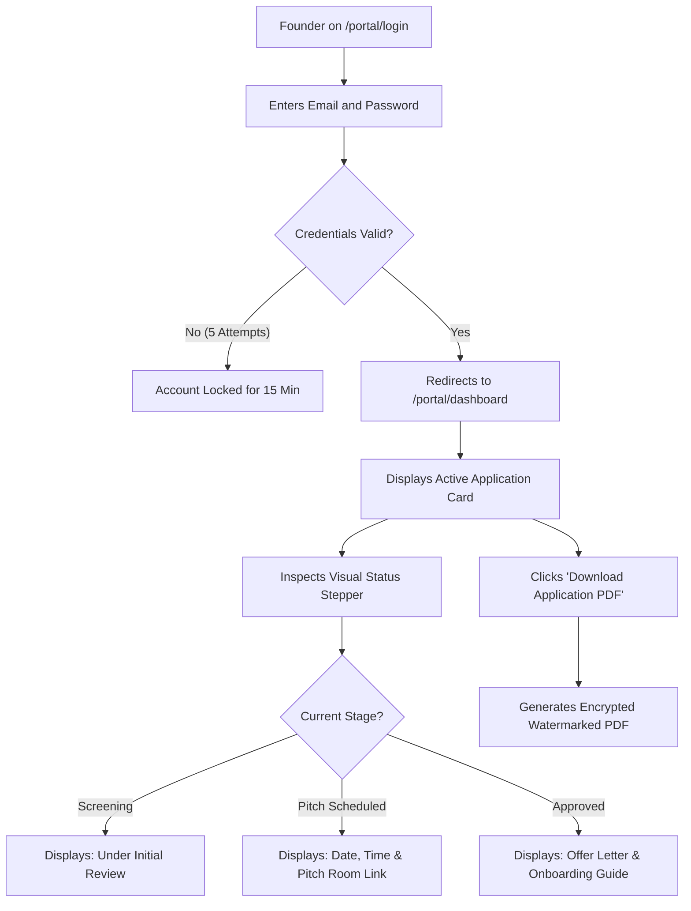
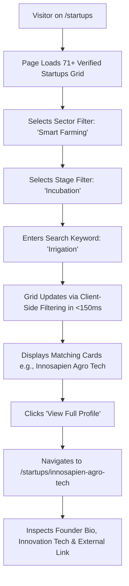
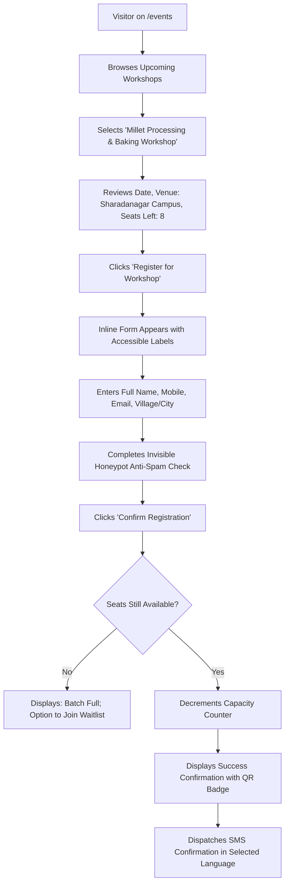
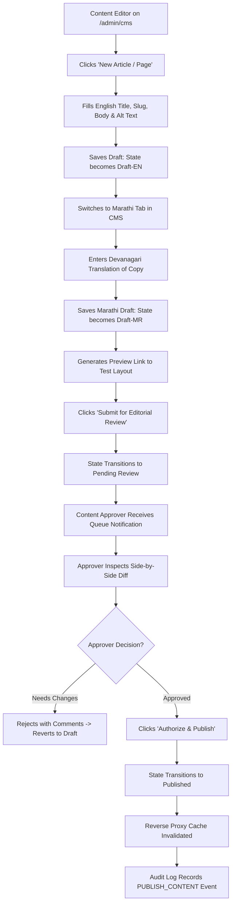
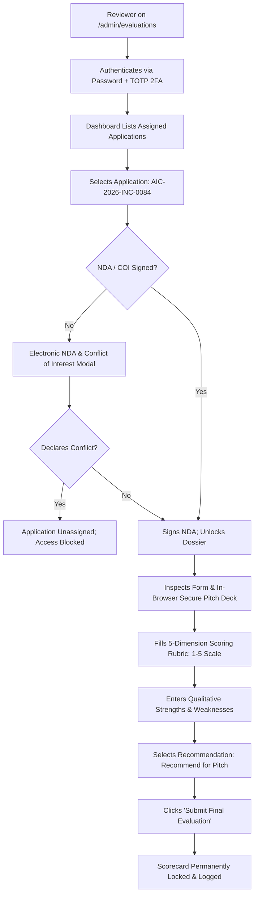
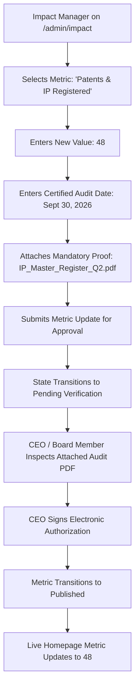
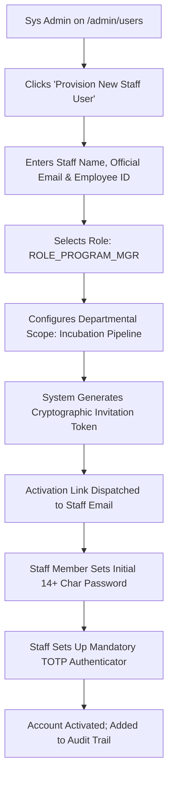

# User Flow & Interaction Specifications
## Next-Generation Digital Platform for AIC-ADT Baramati Foundation

**Document Version:** 1.0.0  
**Status:** Draft — Awaiting Management Review & Approval  
**Date:** October 10, 2026  
**Authors:** Senior UX Strategist, Lead Systems Architect  
**Specification Standard:** Formal Step-by-Step Traversal, Mermaid State Diagrams, Error Gates & Permissions  

---

## 1. Overview of Core Workflows

This document details the exact interaction sequences, decision logic, validation checks, and edge-case handling for the nine essential user journeys identified across the platform.

---

## 2. Journey 1: Founder Discovering and Applying for an Incubation Program

### 2.1. Overview & Permissions
- **Actor:** Startup Founder / Prospective Applicant (`ROLE_ANONYMOUS` transitioning to `ROLE_APPLICANT`).
- **Entry Point:** Public Homepage (`/`) or Programs Directory (`/programs`).
- **Permission Check:** Public access during discovery; authenticated `ROLE_APPLICANT` required to initiate, save, and submit applications.

### 2.2. Flowchart (Mermaid)



### 2.3. Step-by-Step Traversal
1. **Discovery:** Founder arrives on `/programs/incubation`, reviews eligibility criteria, incubation milestones, and seed funding tranches.
2. **Call-to-Action:** Founder clicks *"Apply for Incubation"*.
3. **Authentication Gate:** The platform checks session state. If unauthenticated, routes to `/portal/register`. Founder enters Email, Mobile, Password, and completes 6-digit SMS OTP verification.
4. **Application Workspace:** Founder enters `/portal/applications/new`.
5. **Multi-Step Form Progression:**
   - *Step 1: Founder & Team:* Names, Aadhaar/PAN status, background.
   - *Step 2: Legal Entity:* DPIIT recognition, CIN/LLPIN, UDYAM registration.
   - *Step 3: Agricultural Innovation:* Problem statement, technology novelty, target crop/animal sector.
   - *Step 4: Traction & Lab Needs:* Revenue, pilot testing, lab equipment required (e.g., Analytical Lab GC-MS or Food Retort lines).
   - *Step 5: Document Uploads:* Pitch deck (PDF ≤ 20 MB), certificate of incorporation.
6. **Auto-Save Mechanism:** Form automatically synchronizes to database every 30 seconds and upon step transition.
7. **Legal Declarations:** Founder checks mandatory non-infringement and accuracy declarations.
8. **Submission & Receipt:** Founder clicks *"Submit Final Application"*.

### 2.4. States & Exception Handling
- **Success State:** Screen displays confirmation badge with Application Reference Number (`AIC-2026-INC-0084`), confirmation email dispatched, and status updates to `Submitted`.
- **Validation Errors:** Pitch deck exceeds 20 MB (inline warning: *"File size exceeds 20 MB limit"*); missing required CIN field when marked "Registered Entity".
- **Failure State:** Server storage or network disconnect: draft persists in local indexed storage; notification banner displays *"Offline: edits saved locally; will sync upon reconnection"*.

---

## 3. Journey 2: Returning Applicant Checking Application Status

### 3.1. Overview & Permissions
- **Actor:** Existing Applicant (`ROLE_APPLICANT`).
- **Entry Point:** Top utility bar *"Applicant Portal"* button or direct URL `/portal/login`.
- **Permission Check:** Verified applicant credentials; restricted strictly to applicant's own records.

### 3.2. Flowchart (Mermaid)



### 3.3. Step-by-Step Traversal
1. **Login:** Founder logs in at `/portal/login` via email and password.
2. **Dashboard Overview:** Displays application overview cards:
   - Application ID: `AIC-2026-INC-0084`
   - Program: Incubation (Cohort 2026-B)
   - Submission Date: October 12, 2026
3. **Status Stepper Inspection:** Interactive timeline displays exact milestone:
   - Step 1: `Submitted` (Completed)
   - Step 2: `Initial Screening` (Completed)
   - Step 3: `Pitch Presentation Scheduled` (Active: October 28, 2026, 11:00 AM IST, AIC Boardroom / Virtual Zoom Room)
   - Step 4: `Selection Committee Review` (Pending)
   - Step 5: `Final Outcome` (Pending)
4. **Document Access:** Founder clicks *"Download Submitted Form (PDF)"* to generate an encrypted, watermarked copy for institutional records.

### 3.4. States & Exception Handling
- **Success State:** Visual timeline accurately reflects real-time status; pitch instructions clearly visible.
- **Validation Errors:** Expired session token prompts inline modal re-authentication without loss of screen context.
- **Failure State:** 5 failed login attempts triggers account lockout with automated notification to applicant email.

---

## 4. Journey 3: Visitor Finding a Startup by Sector

### 4.1. Overview & Permissions
- **Actor:** Investor, Researcher, Corporate Partner, or Public Visitor (`ROLE_ANONYMOUS`).
- **Entry Point:** Primary Navigation -> *Startups* (`/startups`).
- **Permission Check:** Fully public.

### 4.2. Flowchart (Mermaid)



### 4.3. Step-by-Step Traversal
1. **Entry:** Visitor clicks *Startups* in the primary header.
2. **Initial Grid:** The directory loads with 71 verified startup profiles, showing company logo, legal name, one-line elevator pitch, and sector pill badges.
3. **Filtering:** Visitor clicks the sector pill *"Smart Farming"*. The URL updates to `/startups?sector=smart-farming` without full-page reload.
4. **Keyword Refinement:** Visitor types *"Deficiency"* or *"Sensor"*.
5. **Results Display:** Card grid filters instantly; live region announces *"4 Startups matching Smart Farming and 'Sensor'"*.
6. **Detailed Profile:** Visitor clicks *"View Full Profile"* on *Innosapien Agro Technologies*, reading about their wearable plant phenomics sensor, founder profiles, and clicking their verified website link.

### 4.4. States & Exception Handling
- **Success State:** Instant filtering; verified startup profiles render cleanly with semantic headers and high-contrast cards.
- **No Results State:** If a query yields zero results (e.g., search for "Crypto"), the grid displays an accessible empty state: *"No startups found matching your filter criteria. Try clearing filters or searching for terms like Agritech, Drones, or Millets"*.

---

## 5. Journey 4: Visitor Registering for an Event

### 5.1. Overview & Permissions
- **Actor:** Farmer, Rural Youth, Student, or Entrepreneur (`ROLE_ANONYMOUS`).
- **Entry Point:** Global Navigation -> *Events* (`/events`) or Marathi Calendar (`/mr/events`).
- **Permission Check:** Fully public intake.

### 5.2. Flowchart (Mermaid)



### 5.3. Step-by-Step Traversal
1. **Event Discovery:** Visitor navigates to `/events`, filters by *"Food Innovation Workshops"*, and selects *"Millet Entrepreneurship Development Programme"*.
2. **Details Review:** Reviews date (November 14, 2026), location (Food Incubation Centre, 6th Floor, AIC-ADT Building, Sharadanagar, Baramati), and remaining seats (8 of 30 remaining).
3. **RSVP Intake:** Visitor clicks *"Register for Workshop"*.
4. **Form Completion:** Fills Name, Mobile Number, Email, and District/Village.
5. **Submission:** Clicks *"Confirm Registration"*.

### 5.4. States & Exception Handling
- **Success State:** Instant registration confirmation screen with Registration ID (`EVT-2026-MLT-0023`); SMS receipt sent immediately to attendee mobile.
- **Capacity Exhaustion (Race Condition):** If the final seat is claimed while the visitor is typing, submission returns: *"We apologize, the final seat was just booked. Would you like to be added to the priority waitlist for the next batch?"*.
- **Validation Errors:** Invalid 10-digit Indian phone number triggers inline error: *"Please enter a valid 10-digit mobile number"*.

---

## 6. Journey 5: Visitor Downloading an Annual Report

### 6.1. Overview & Permissions
- **Actor:** Institutional Partner, NITI Aayog Auditor, Researcher, Public (`ROLE_ANONYMOUS`).
- **Entry Point:** Global Navigation -> *Resources* -> *Annual Reports* (`/resources/annual-reports`).
- **Permission Check:** Public access.

### 6.2. Flowchart (Mermaid)

```mermaid
graph TD
    A[Visitor on /resources/annual-reports] --> B[Browses Chronological Report Archive]
    B --> C[Selects 'Annual Progress Report FY 2025-26']
    C --> D[Inspects Document Metadata: PDF, 8.4 MB, Audited]
    D --> E[Clicks 'Download Report (PDF)']
    E --> F[Browser Requests /api/v1/publications/annual-report-2025-26.pdf]
    F --> G[Server Injects Strict Content-Disposition & Cache Headers]
    G --> H[File Streams to User; Zero Mixed-Content Warnings]
```

### 6.3. Step-by-Step Traversal
1. **Entry:** Visitor clicks *Resources* in the global header and selects *Annual Reports*.
2. **Archive Browsing:** The page renders cards for all institutional reports from FY 2019–20 through FY 2025–26.
3. **Selection:** Visitor locates *"AIC-ADT Annual Institutional Progress Report 2025–26"*, viewing publication date, page count, and file size (8.4 MB).
4. **Download:** Visitor clicks *"Download Report (PDF)"*. The file downloads directly from the secure local data-center storage with strict HTTPS and anti-virus headers.

### 6.4. States & Exception Handling
- **Success State:** File streams securely to device; zero mixed-content or untrusted domain warnings.
- **Network Glitch:** Resumable HTTP byte-range requests enable pausing and resuming large downloads on unstable rural connections.

---

## 7. Journey 6: Content Editor Publishing an English and Marathi Page

### 7.1. Overview & Permissions
- **Actor:** Internal Staff Content Editor (`ROLE_CONTENT_EDITOR`) and Approver (`ROLE_CONTENT_APPROVER`).
- **Entry Point:** Administrative Console (`/admin/cms`).
- **Permission Check:** Editor can create/edit and submit drafts; only Approver can publish live.

### 7.2. Flowchart (Mermaid)



### 7.3. Step-by-Step Traversal
1. **Creation:** Content Editor logs into `/admin/cms`, selects *Infrastructure*, and clicks *"Add Lab Equipment Profile"*.
2. **English Drafting:** Inputs English content, attaches high-resolution equipment photo with accessible alt text, and saves draft.
3. **Marathi Translation:** Clicks the *"Marathi (मराठी)"* tab in the CMS editor, provides accurate Devanagari translation, and saves.
4. **Review Submission:** Editor clicks *"Submit for Approval"*. The page state transitions to `Pending Review`.
5. **Approver Gate:** Content Approver (CEO or Communications Head) reviews the side-by-side English/Marathi diff.
6. **Publication:** Approver clicks *"Approve and Publish"*. Both English and Marathi routes become live simultaneously.

### 7.4. States & Exception Handling
- **Success State:** Both routes live instantly; reverse proxy cache cleared; audit log records publisher ID and timestamp.
- **Validation Errors:** Missing Marathi translation when mandatory translation toggle is enabled blocks submission: *"Please complete the Marathi translation before submitting for review"*.
- **Permission Rejection:** If a Content Editor attempts an unauthorized direct API call to `/publish`, the system returns `HTTP 403 Forbidden`.

---

## 8. Journey 7: Reviewer Evaluating an Assigned Application

### 8.1. Overview & Permissions
- **Actor:** Empaneled Mentor or Investor Reviewer (`ROLE_REVIEWER`).
- **Entry Point:** Secure email notification link or `/admin/evaluations`.
- **Permission Check:** 2FA-authenticated `ROLE_REVIEWER`; assigned explicitly to the target application.

### 8.2. Flowchart (Mermaid)



### 8.3. Step-by-Step Traversal
1. **Authentication:** Reviewer authenticates with corporate credentials and TOTP 2FA.
2. **Dossier Selection:** Clicks assigned application `AIC-2026-INC-0084` (*"Innosapien Agro Technologies"*).
3. **Mandatory Conflict of Interest Gate:** An un-dismissible modal appears. Reviewer confirms no familial or financial conflict of interest and signs the electronic institutional NDA.
4. **Dossier Review:** Reviewer views founder responses and evaluates the pitch deck in the secure in-browser PDF reader (download and print disabled).
5. **Scoring:** Completes 5 standardized evaluation dimensions (Innovation, Agricultural Impact, Market Feasibility, Team, Infrastructure Fit) on a 1–5 scale.
6. **Submission:** Submits scorecard. System calculates weighted composite score and locks record.

### 8.4. States & Exception Handling
- **Success State:** Scorecard submitted successfully; Program Manager dashboard notified; review marked complete.
- **Conflict Declared:** If reviewer checks *"I hold equity in a competing entity"*, the dossier is immediately locked, unassigned, and returned to the Program Manager queue.

---

## 9. Journey 8: Impact Manager Updating a Metric for a Reporting Period

### 9.1. Overview & Permissions
- **Actor:** Impact Data Manager (`ROLE_IMPACT_MGR`) and Approver (`ROLE_CONTENT_APPROVER`).
- **Entry Point:** Administrative Console -> *Impact Metrics* (`/admin/impact`).
- **Permission Check:** Impact Manager drafts; CEO / Board Approver authorizes live publication.

### 9.2. Flowchart (Mermaid)



### 9.3. Step-by-Step Traversal
1. **Initiation:** Impact Data Manager accesses `/admin/impact`.
2. **Metric Selection:** Selects metric *"Total Patents & IP Registered"*.
3. **Data Entry:** Updates count from 42 to 48; sets audit date to *September 30, 2026*.
4. **Mandatory Verification Gate:** Uploads official supporting document (`IP_Register_Q2_2026.pdf`) signed by the IP Facilitation Cell.
5. **Submission:** Submits for executive sign-off.
6. **Executive Sign-Off:** CEO reviews the uploaded register and clicks *"Authorize Public Metric"*.
7. **Live Update:** Public homepage and impact dashboard render the new verified number immediately.

### 9.4. States & Exception Handling
- **Success State:** Metric updates sitewide with verified audit date; audit log records approving executive ID.
- **Missing Proof Document:** Submitting an updated metric without attaching the mandatory proof file is blocked by form validation: *"A signed verification document is required to update certified impact metrics"*.

---

## 10. Journey 9: System Administrator Creating a User and Assigning Permissions

### 10.1. Overview & Permissions
- **Actor:** System Administrator (`ROLE_SYS_ADMIN`).
- **Entry Point:** Administrative Console -> *User Management* (`/admin/users`).
- **Permission Check:** System Administrator restricted to campus subnet or authenticated administrative VPN.

### 10.2. Flowchart (Mermaid)



### 10.3. Step-by-Step Traversal
1. **Entry:** System Administrator logs in at `/admin/users` via campus VPN and hardware token.
2. **User Details:** Clicks *"Provision New Staff User"*, entering Full Name, Official `@adtbaramati.com` Email, and Department.
3. **Role Assignment:** Selects `ROLE_PROGRAM_MGR` from the RBAC role dropdown.
4. **Activation Dispatch:** Clicks *"Send Activation Invitation"*. The system generates a single-use, 24-hour expiring activation link.
5. **Staff Onboarding:** The new staff member receives the link, establishes a strong password (14+ chars), and pairs their mobile authenticator app.

### 10.4. States & Exception Handling
- **Success State:** Staff user activated with correct role boundaries; audit log records administrator ID, assigned role, and timestamp.
- **Privilege Escalation Block:** Attempting to assign `ROLE_SYS_ADMIN` without dual-authorization from the IT Director triggers a dual-custody verification prompt.
